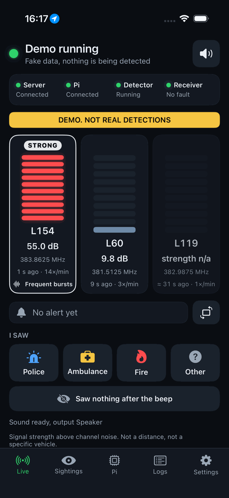
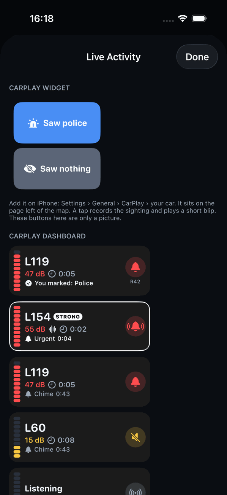
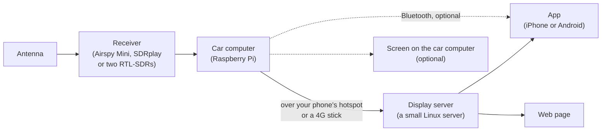

# Slot17

Slot17 is a research tool that recognises TETRA radio bursts by the public training pattern that the ETSI standard (EN 300 392-2) puts inside every burst. A small computer with a radio receiver, for example in a car, listens to the band, and a phone or web page shows what it hears, with signal bars and an optional sound.

TETRA is a digital radio standard. In many countries emergency services are among its users.

**Slot17 is not a police or emergency-vehicle detector, and it is not a product.** It shows that a radio transmitted and how strong the signal was; nothing more. See [LEGAL.md](LEGAL.md) before you build or use it.

> **What a match means:** a TETRA radio transmitted and the receiver heard it. A match does **not** identify police, an ambulance, a radio or a vehicle, and it does not measure distance. A vehicle whose radio is silent is invisible. Radios in buildings, parked cars or carried on foot look the same as one coming towards you. [TETRA-SIGNALS.md](docs/design/TETRA-SIGNALS.md) explains why.

It only listens to the TETRA band: it never transmits there, and it never decodes, decrypts or listens to what anyone says. The car computer sends its own results over Wi-Fi, 4G or Bluetooth.

**Status:** it runs in daily drives in the Netherlands, Belgium and Germany. How far away it hears a radio depends on the antenna, the car and the land in between, and it never tells you a distance. See [Limits](#limits).

**Questions?** The [FAQ](docs/FAQ.md) answers the common ones: range, false beeps, which receiver, which countries, hosted servers and the apps. For help or ideas, join the [Slot17 Discord](https://discord.gg/rSFPWSWNfh). The website is [slot17.cloud](https://slot17.cloud).

<table>
<tr>
<td align="center" width="33%"><br>The app</td>
<td align="center" width="33%"><br>On CarPlay (preview)</td>
<td align="center" width="33%"><br>The web page</td>
</tr>
</table>

These show demo data. More pictures are in [SCREENSHOTS.md](docs/SCREENSHOTS.md).

## Contents

1. [How it works](#how-it-works)
2. [Does it work in my country?](#does-it-work-in-my-country)
3. [What you need](#what-you-need)
4. [Step 1: Prepare the car computer](#step-1-prepare-the-car-computer)
5. [Step 2: Set up the display server](#step-2-set-up-the-display-server)
6. [Step 3: Set up the car computer](#step-3-set-up-the-car-computer)
7. [Step 4: Install the app](#step-4-install-the-app)
8. [Daily use](#daily-use)
9. [Updating](#updating)
10. [Troubleshooting](#troubleshooting)
11. [Reading a session](#reading-a-session)
12. [Tests](#tests)
13. [Security](#security)
14. [Limits](#limits)
15. [Repository layout](#repository-layout)
16. [Community](#community)
17. [License](#license)

## How it works



1. The **antenna and receiver** pick up the radio band TETRA uses.
2. The **car computer** looks for the fixed training pattern in the middle of every TETRA burst, four times a second, on all 200 channels of 380–385 MHz. It runs by itself from the moment the car powers it.
3. It sends what it hears through your **phone's hotspot** (or a 4G stick) to a **display server** on the internet, and, if you want, straight to the app over **Bluetooth** as well. Over Bluetooth the app works with **no internet in the car at all** (since 1.6.0).
4. The **app** (iPhone or Android), the **web page** or a **screen on the car computer** itself shows the signal bars and plays a sound for strong signals. From the app you can also mark what you saw, stop the detector, power off the car computer, run its setup check and make a support package.

Why a separate server? The car computer sits behind your phone's hotspot, so the phone can't reach it over the internet. Both can reach a server on the internet. Nothing on the internet ever connects to the car computer itself; the only thing that can is your phone over Bluetooth, if you switch that on. Bluetooth needs no internet, but it still needs the server once, to set it up; [Bluetooth or the server?](#bluetooth-or-the-server) compares the two.

## Does it work in my country?

Slot17 recognises **TETRA**. It was built in the **Netherlands**, on the C2000 network, and runs in daily drives there and in **Belgium** and **Germany**. Out of the box it listens to **380–385 MHz**, the band where the radios in vehicles and on people transmit.

| Situation | What to expect |
|---|---|
| Your emergency services use TETRA in 380–385 MHz | This is the setup Slot17 is built for. In Europe this band is set aside for emergency services, and many countries use it. It runs in daily drives in the Netherlands, Belgium and Germany, and the same band is used in, for example, the United Kingdom, the Nordic countries and Austria |
| They use TETRAPOL, as in France and Switzerland | Slot17 won't recognise it. TETRAPOL is a different system |
| They use TETRA on other frequencies, which is common outside Europe | Not supported. The detector's channel grid is built for 380–385 MHz, and choosing another centre frequency doesn't add one. Don't buy hardware for another band |
| They use other digital radio, such as P25 in the US, DMR, or LTE-based systems | Not supported |

Check which system your country uses before buying anything. Also check the law: receiving this band, or using such equipment in a vehicle, may be restricted where you live.

## What you need

These are the parts we use. Equivalent parts should work too. **Where to buy them in your country, with prices and a total:** [slot17.cloud/parts/](https://slot17.cloud/parts/) (also in [Dutch](https://slot17.cloud/nl/parts/), [German](https://slot17.cloud/de/parts/) and the site's other languages). It picks your country by itself and shows only that country's shops.

| Part | What we use | Alternatives and advice |
|---|---|---|
| **Car computer** | [Raspberry Pi 5](https://www.raspberrypi.com/products/raspberry-pi-5/), 8 GB | Any memory size from 2 GB up should do: the detector uses about 0.6 GB. We have only tested the Raspberry Pi 5; slower computers may not keep up |
| **Storage** | 512 GB NVMe SSD (a fast solid-state drive that fits in the case) | A good microSD card of 128 GB or more works too: since 1.5.1 the recordings are written in batches, so even a slow card keeps up with a busy band, and detection never waits for the storage. Recordings grow with every drive: ours collected about 155 GB in two months. Recording pauses when less than 5 GB is free |
| **Case** | Argon case with NVMe slot | Any case with cooling. A car gets hot in summer |
| **Power in the car** | [UGREEN Nexode 60 W car charger, EC602](https://www.amazon.nl/dp/B0DSBSBSGW), Pi on its built-in USB-C cable | It gives 3 A at 5 V. That was enough for our Pi 5 with the Airspy, an NVMe SSD and a 4G stick: no undervoltage during a whole drive (19 November 2026). Bigger car chargers don't help: almost all give 3 A at 5 V, and their extra watts are at 9 to 20 V, which the Pi doesn't use. A car charger that offers the Pi 5's own 5 V 5 A profile is very rare. If `setup.sh doctor` reports undervoltage, your setup draws more: use a 12 V to 5 V converter rated for 5 A with a fused lighter plug or a fused connection, and tell the Pi it can draw 5 A with `sudo rpi-eeprom-config --edit`, adding `PSU_MAX_CURRENT=5000` (only with a supply that really gives 5 A) |
| **Receiver** | [Airspy Mini](https://itead.cc/product/airspy-mini/) | Its antenna socket is SMA (the common screw-on radio connector). Since 1.7.0 also the SDRplay RSP1B and RSP1A, and a pair of RTL-SDRs, each half of the band on one stick. Their code is checked against the receivers' own header files and stand-ins; [RECEIVERS.md](docs/design/RECEIVERS.md) explains each |
| **Antenna** | [Motorola GMAE4258B](https://www.firecom.nl/merken/motorola/motorola-gmae4258b/), a hidden TETRA antenna for 380–410 MHz, stuck inside the front windscreen | Any antenna made for 380–400 MHz works. **An antenna on the outside of the car, such as a magnetic roof antenna, receives better** than one inside. Some windscreens have a metal coating that blocks radio signals. You may need an adapter to the Airspy's SMA socket |
| **Internet in the car** | The iPhone's personal hotspot, or a ZTE MF833N 4G USB stick with its own SIM | Any hotspot or car Wi-Fi works and needs nothing extra. A 4G stick spares the phone's battery; ours needs one extra setup command on a Raspberry Pi 5, see [the optional step](#optional-a-4g-stick-instead-of-the-hotspot). A stick that Linux recognises by itself needs no setup at all. **With Bluetooth you can drive without it** (since 1.6.0); what you then miss is in [Bluetooth or the server?](#bluetooth-or-the-server) |
| **Display server** | A hosted server from us, or your own | Needed with Bluetooth too, for the set-up. Ours: one command in the Discord, nothing to rent; see [step 2](#step-2-set-up-the-display-server). Your own: any Debian or Ubuntu machine with a public address that the car and phone can reach, such as a cheap VPS (a small Linux computer you rent on the internet). A home computer works if you forward a port on your router |
| **Phone** | iPhone with iOS 16.2 or newer | An Android phone with Android 8 or newer works too, with its own app. The iPhone's Live Activity, widget and Bluetooth need iOS 18, and showing the Live Activity on CarPlay needs iOS 26. Computers can use the web page |
| **Notifications (optional)** | [Pushover](https://pushover.net) | Only for fault messages, such as "receiver hears nothing". The apps can show the same faults themselves (Settings, Fault messages) and switch Pushover off and on; their notifications work only while the app runs |

You also need a computer to set things up. Windows, macOS and Linux all work.

Not used to Linux? [SETUP-WITH-AI.md](docs/SETUP-WITH-AI.md) has a prompt for any AI chat assistant that then walks you through these steps one at a time and checks each one.

## Step 1: Prepare the car computer

**Before you start:** do [step 2](#step-2-set-up-the-display-server) first. It takes two minutes in the Discord and gives you the server address and car computer key that the car computer needs.

**The easy way: the ready-made image.** The [latest release](https://github.com/efeorman/Slot17/releases/latest) has `slot17-VERSION-raspios-lite-arm64.img.xz` under **Assets** (it appears about an hour after a new release): Raspberry Pi OS Lite with Slot17 on it and SSH on. Flash it with [Raspberry Pi Imager](https://www.raspberrypi.com/software/) (**Use custom**, then the file), set a username, password and Wi-Fi in Imager's **Customisation**, and write it. **If Imager shows no Customisation for the file, don't use it:** without a username the card can't set itself up. Follow the steps by hand below instead. Then open the card's **bootfs** drive on your computer, fill in **slot17.txt** (your server address and car computer key from step 2, and your phone's hotspot; leave the hotspot empty if you'll use Bluetooth alone, which the card has on by default) and start the Pi with it. Fill in the server address and key before the first start: the card reads them only once. It sets itself up in about 5 minutes and then removes the key and the password from the card; if something goes wrong, **slot17-setup.log** on the card says what. Then go on to [step 4](#step-4-install-the-app). [BUILD.md](docs/BUILD.md) walks through the whole build, hardware included.

**Writing to an NVMe SSD or a card:** Imager writes to storage connected to your computer. Connect an NVMe SSD with a USB enclosure for NVMe drives before it goes into the Pi's case, and a microSD card with a card reader. Writing erases the drive, so check its name and size in Imager.

The steps below do the same by hand.

**1. Put an operating system on its storage.**
1. Install [Raspberry Pi Imager](https://www.raspberrypi.com/software/) on your computer and open it.
2. Choose your Raspberry Pi model (**Device**), then **Raspberry Pi OS (other) > Raspberry Pi OS Lite (64-bit)** (**OS**), then your microSD card or SSD (**Storage**).
3. In **Customisation**, fill in:
   - **Hostname:** for example `slot17`.
   - **Localisation:** your country and time zone.
   - **User:** a username and password. Remember these.
   - **Wi-Fi:** your **phone's hotspot name and password**, so it gets internet in the car. You can add your home Wi-Fi later. Using Bluetooth alone in the car? Then your home Wi-Fi is enough: the car computer needs internet to install and set up, and later for updates.
   - **Remote access:** turn on **Enable SSH** with password authentication.
4. Write the image (**Writing**), and let Imager verify it.

On an iPhone, the hotspot is under **Settings > Personal Hotspot**. Turn on **Maximise Compatibility** if the computer can't find it.

**2. Connect the hardware.**
1. Plug the antenna into the receiver. Two RTL-SDR sticks each need the antenna's signal: use a splitter for 380 to 400 MHz, or two antennas.
2. Plug the receiver into a blue **USB 3** port on the Raspberry Pi.
3. Insert the storage and connect the power.

**3. Log in to it from your computer.** SSH lets you type commands on the car computer from your own computer.
1. Turn on your phone's hotspot, and connect your computer to the same hotspot (or have both on your home Wi-Fi).
2. Wait about two minutes after power-up.
3. Open **PowerShell** on Windows or **Terminal** on a Mac, and type, using your username and hostname:

```bash
ssh yourname@slot17.local
```

The first time, type `yes` to trust it, then your password (nothing appears while you type it). You now control the car computer.

If `slot17.local` isn't found, use the car computer's address instead, such as `ssh yourname@192.168.1.42`. Your router's or hotspot's list of connected devices shows it, or type `hostname -I` on the Pi with a keyboard and screen attached.

**4. Optional: add your home Wi-Fi**, so you can work on it at home, and so it gets updates there when the car has no internet. Replace the name and password with yours:

```bash
sudo nmcli device wifi connect "Your home Wi-Fi" password "your-wifi-password"
```

## Step 2: Set up the display server

Do this first, because it gives you the address and key that the car computer needs. There are two ways: a server we host for you, or your own.

**Using Bluetooth? You still need a server**, but only to set things up. The app gets its private link and the car computer's Bluetooth key through it, and the car computer's setup offers Bluetooth only once it is connected to a server. After that the app works over Bluetooth without internet in the car, and the server is there for the extras: the web page, updates, drive reports and support packages. For that, the hosted server is the easy choice: it costs nothing and you don't have to keep it running. [Bluetooth or the server?](#bluetooth-or-the-server) compares the two.

### Option A: a hosted server from us

1. **Join the [Slot17 Discord](https://discord.gg/rSFPWSWNfh).**
2. **Type `/server create`** in any channel. The bot answers in a message only you can see, with:
   - your **private link**, for the app and the web page;
   - your **server address**, such as `https://k7f2q.slot17.cloud`, and your **car computer key**, for the next step.
3. **Copy them somewhere safe.** They aren't shown again. Anyone with the private link can see your car's data and stop the detector.

The server is linked to your Discord account. Other commands, again only visible to you:

| Command | What it does |
|---|---|
| `/server info` | Your server's address, whether it runs, when your car computer last sent something, the detector's state and what is stored |
| `/server new-keys` | New keys; the old link and car computer key stop working |
| `/server delete` | Deletes your server and everything on it. The address is never handed out again |

Each hosted server is a separate copy with its own address, keys and folder; other people's servers can't reach it. What it stores and who can see it: [slot17.cloud/privacy.html](https://slot17.cloud/privacy.html). Then go on to [step 3](#step-3-set-up-the-car-computer).

### Option B: your own server

1. **Log in to your server** with the details from your hosting provider, for example `ssh root@203.0.113.5`.
2. **Use a normal user, not root.** If the provider only gave you root, create a user first:

```bash
adduser yourname
usermod -aG sudo yourname
su - yourname
```

3. **Run the installer** and wait for it to finish. A server of your own uses plain HTTP: your private link and the car's data travel unencrypted (a hosted server uses HTTPS). See [Security](#security).

```bash
curl -fsSL https://github.com/efeorman/Slot17/releases/latest/download/install.sh | bash -s -- server
```

At the end it prints three things. **Copy them somewhere safe:**

| What it prints | What it's for |
|---|---|
| Your **private link** | Opens the web page and connects the app. Treat it like a password, because anyone with it can also stop the detector and power off the car computer |
| The **server address** and **car computer key** | For the next step |
| An **on/off link** | Optional, for a phone shortcut that tells you whether the car computer is running |

You can print them again at any time with `bash ~/Slot17/setup.sh server --show`.

The address it prints is the server's public internet address, which it looks up for you. If that's wrong, for example behind a router, give the right one: `bash ~/Slot17/setup.sh server --address 203.0.113.5`.

**The server must be reachable from the internet on port 5732.** The installer opens that port in `ufw` (Linux's firewall) if it's in use, but many hosting providers also have their own firewall in their web dashboard; allow incoming TCP on port 5732 there. To test, open the server address it printed with `/healthz` after it, for example `http://203.0.113.5:5732/healthz`, on your phone with Wi-Fi **off**: it should say `ok`.

## Step 3: Set up the car computer

On the car computer (logged in as in step 1), run:

```bash
curl -fsSL https://github.com/efeorman/Slot17/releases/latest/download/install.sh | bash -s -- car
```

It installs everything and runs the detector's own tests (about a minute; they never open the receiver). Then it asks a few questions, and explains each one:

| Question | Our advice |
|---|---|
| Save your phone's hotspot as a Wi-Fi network? | **Yes.** Type its name and password; the car computer then joins it by itself on every drive. Not asked when it is already saved. Using Bluetooth alone in the car? Then you can say no |
| Install updates by themselves? | **Yes.** It then installs new versions signed by the Slot17 team at a start; see [Updates by themselves](#updates-by-themselves) |
| Connect to a display server? | **Yes.** Paste the server address and the car computer key from step 2. Needed for Bluetooth too: without it, the next question is skipped |
| Send alerts over Bluetooth too? | **Yes**: the app then gets everything straight from the car computer, also without internet. Say no if you'd rather the car computer weren't visible to Bluetooth scanners nearby, or what it sends readable by a phone nearby. It then asks for the name phones show (Enter keeps **Slot17**). See [Bluetooth to the app](#optional-bluetooth-to-the-app) |
| Set up Pushover notifications? | Optional. You need a Pushover app token and user key |
| Calibrate the receiver? | **Yes**, once, with the antenna connected. It measures how far your receiver's frequency is off, which differs per receiver |
| Start it now? | **Yes**. Not asked after a calibration: the receiver is opened only once per power-up, so the detector then starts at the next power-up |

From now on the detector **starts by itself every time the car computer gets power**. You don't need to log in again for normal use.

To see what is installed, without changing anything:

```bash
bash ~/Slot17/setup.sh car --check
```

**Changing a setting later.** The detector runs as a background service (`tetra-detector.service`), which
`systemctl` starts and stops. The setup only runs with the detector stopped, and it asks again whether to calibrate
and start. Say no to both, or add `--no-calibrate --no-start`: the receiver was already opened once in this power-up,
and a second opening can make it stop responding. The detector starts again at the next power-up. For example:

```bash
sudo systemctl stop tetra-detector.service
bash ~/Slot17/setup.sh car --bluetooth --no-calibrate --no-start
```

### Optional: a 4G stick instead of the hotspot

A 4G USB stick with its own SIM gives the car computer internet without your phone. The hotspot stays as the fallback: the car computer uses a wired network first, then the stick, then Wi-Fi. With Bluetooth you don't need either for the app; a stick then only adds what goes through the server, such as the web page and updates on the road.

We use a **ZTE MF833N**. A Raspberry Pi 5 can't use that stick as it comes, so it needs one more command, with the stick plugged in and the detector stopped:

```bash
bash ~/Slot17/setup.sh modem
```

It installs a USB fix made by someone else and a small check of ours that keeps the stick connected. That check switches the stick's data roaming on; to keep your own setting, see [MOBILE-MODEM.md](docs/operations/MOBILE-MODEM.md#what-the-setup-installs-part-2-keep-the-data-session-up-and-rank-the-route) before you run it. [MOBILE-MODEM.md](docs/operations/MOBILE-MODEM.md) explains both, what was tested, and what to know about other sticks.

- **Plug the stick into the other blue USB 3 port**, not next to the receiver on the same controller: each blue port of a Pi 5 has its own USB controller, and `lsusb -t` should show the receiver and the stick under different `Bus` lines. On the same controller, the receiver lost samples while the stick started, on three of four starts.
- **Leave the hotspot switched on for the first drives.** On our first drive the stick lost its mobile connection once for eight minutes, and with no hotspot the phone had nothing from the car for that time.

### Optional: Bluetooth to the app

Besides the display server, the car computer can talk to the app straight over Bluetooth. Since 1.6.0 that carries everything the app needs in the car: the alerts, the whole **Pi** screen with the car computer's health and setup check, and the app's buttons (sightings, stop, power off, the Pushover switch, the Pi log and asking for a support package). So the app keeps working where **neither the phone nor the car computer has internet**. Setup asks about it (yes by default); `bash ~/Slot17/setup.sh car --bluetooth` or `--no-bluetooth` changes it later (see [Changing a setting later](#step-3-set-up-the-car-computer)), and so does the app.

- **In the app:** Settings, **Bluetooth to the car computer**, **Set up**, with the car computer on and nearby. The first time, the app gets the car computer's key through the server, so both need internet once (at home is fine); then the phone shows a list to pick it from. Setting it up again later needs no server. The same card switches Bluetooth on and off on the car computer and renames it (with the phone connected, off and renaming go straight over Bluetooth; on goes through the server), and shows which route brought each match first.
- **Needs:** car computer software 1.6.0 for everything (1.4.0 sends only the alerts and the detector's state), iPhone app 1.9.0 on iOS 18 or Android app 1.11.0, and a car computer with Bluetooth (every Raspberry Pi from the 3 on has it).
- **Measured** from a PC to our car computer: found in 0.2 s, connected in 0.9 s, 0 of 161 frames lost, round trip 79 ms. In another room, at −80 to −90 dBm, the PC saw it but could not connect: Bluetooth is for a phone in the car.

#### Bluetooth or the server?

Use both, which is the default: a match that comes both ways beeps once, and an action that gets no answer over Bluetooth within 8 s also goes through the server.

| | Bluetooth | Display server |
|---|---|---|
| **Internet** | Not needed | Needed by the car computer and the phone |
| **Speed** | Round trip 79 ms (measured from a PC) | 0.18 to 0.28 s per push usually, then up to 0.25 s until the phone picks it up; 2.8 s or more in 1 minute of 10; nothing for minutes when the car's mobile connection drops |
| **Range** | The car: the phone must be near the car computer | Anywhere with internet |
| **Who can watch** | Phones with the app, set up for this car computer | The app and the web page, on any number of phones and computers, also at home |
| **What it carries** | Alerts, the Pi screen, sightings, stop, power off, the Pushover switch, the setup check, the Pi log, asking for a support package | All of that, plus switching Bluetooth on, the Bluetooth key, the web page, the drive report with the car computer's figures, the car computer's log every ten minutes, support packages, and the signed updates for the car computer |
| **Set-up** | Needs the server once, for the key; an iPhone needs iOS 18 | The private link |
| **Privacy** | Signed, not encrypted: a phone nearby that connects can read what the car computer sends; the car computer is visible to Bluetooth scanners nearby, under its name, whenever Bluetooth is on. See [Security](#security) | A hosted server uses HTTPS; a server of your own uses plain HTTP |

Without internet in the car you therefore miss the web page and anyone watching from elsewhere, the car computer's part of the drive report, and support packages (make those at home). Updates come when it starts with a network, such as your home Wi-Fi.

[BLUETOOTH.md](docs/design/BLUETOOTH.md) explains how it works, the frames, the key and what each phone does.

### Optional: a screen on the car computer

A screen attached to the car computer (for example an HDMI touchscreen in a Pi case) can show the display page full screen from the moment the car powers it. It is served by the car computer itself: no server, internet or phone in between, so it is faster than a phone and works without signal. It opens in drive mode at every power-up, with one bar for the strongest channel or three for the three strongest, whichever was last chosen on it.

It needs the car computer connected to a display server once, as Bluetooth does: the part that feeds the screen is set up with that connection. With the detector stopped:

```bash
bash ~/Slot17/setup.sh car --screen --no-calibrate --no-start      # off again: --no-screen instead of --screen
```

How it works, and what to watch for if the receiver goes in the same case: [CAR-SCREEN.md](docs/design/CAR-SCREEN.md).

## Step 4: Install the app

There is an app for iPhone and one for Android. Without either, open your private link in any browser and tap **Start**.

### iPhone

Apple only allows App Store apps to be installed normally, and Slot17 isn't in the App Store, so you sign it yourself.

1. **Download the app file.** On the [latest release](https://github.com/efeorman/Slot17/releases/latest), download **Slot17.ipa**.
2. **Sign and install it** with one of these:

| Option | Cost | How long it keeps working | How |
|---|---|---|---|
| **[Signulous](https://www.signulous.com)** | $19.99 a year per iPhone | A year | Register your iPhone on [signulous.com/register](https://www.signulous.com/register), ideally by opening that page in Safari on the iPhone and choosing **Link this device**. Install the profile it gives you. Then upload **Slot17.ipa** with Signulous's own-app signing and install it, following their current instructions |
| **[Sideloadly](https://sideloadly.io)** | Free, with a normal Apple ID | 7 days; Sideloadly can sign it again by itself before then (its auto-refresh) | On Windows, first install the **web versions** of iTunes and iCloud that Sideloadly's page links to, not the Microsoft Store ones. Install Sideloadly on Windows or a Mac, connect the unlocked iPhone with a cable and trust the computer, drag **Slot17.ipa** onto Sideloadly, sign in with your Apple ID and press **Start**. Then allow your Apple ID under **Settings > General > VPN & Device Management** |

We used Sideloadly at first and use Signulous now (since app 1.5.1). With Signulous the sighting widget's App Group gets a name of Signulous's own; the app finds it by itself. Signing services like it depend on Apple's certificates, which Apple can revoke.

3. **On iOS 16 and newer, turn on Developer Mode** if the iPhone asks: **Settings > Privacy & Security > Developer Mode**, then restart.
4. **Open Slot17 and paste your private link** from step 2. It's stored in the iPhone's Keychain.
5. **Set up Bluetooth** (optional, iOS 18): Settings, **Bluetooth to the car computer**, **Set up**, with the car computer on and nearby, then pick it from the list. From then on the app also works in the car without internet; see [Bluetooth to the app](#optional-bluetooth-to-the-app).

### Android

1. **Download the app file.** On the [latest release](https://github.com/efeorman/Slot17/releases/latest), open **Slot17.apk** on the phone.
2. **Install it.** Android asks once whether your browser or file manager may install apps; allow it for this one install. The app is signed with our own key, so later versions install over it and keep your settings.
3. **Open Slot17 and paste your private link** from step 2.
4. **Allow notifications, then in Settings tap Let Slot17 run in the background.** It keeps a notification while it listens, which lets it play the beeps with the screen off. Some phones (Samsung, Xiaomi, Huawei) also need battery optimisation turned off for Slot17 in the phone's own settings.
5. **Set up Bluetooth** (optional): Settings, **Bluetooth to the car computer**, **Set up**, with the car computer on and nearby. Allow **Nearby devices**, and keep Location on while the phone looks for it. From then on the app also works in the car without internet.

It does the same as the iPhone app; [android/README.md](android/README.md) lists where it differs (a notification instead of the Live Activity, Quick Settings tiles instead of Control Center controls).

**In Android Auto** an urgent beep also shows as a message from Slot17, which Android Auto reads out; say "police", "ambulance", "fire" or "nothing" to mark what you saw. Because the app isn't from Google Play, Android Auto only shows these with **Unknown sources** on: in the Android Auto settings on your phone, tap **Version** 10 times, open **Developer settings** from the menu and tick **Unknown sources**. To switch the messages off: the app's **Settings > Android Auto**.

## Daily use

1. **Start the car.** The car computer powers up, joins your phone's hotspot and starts listening by itself. Keep your hotspot on, unless you use Bluetooth alone; then the phone only needs to be in the car.
2. **Open the Slot17 app once, then lock the phone.** iOS doesn't let an app start sound from the background, so opening it is what arms the sound. On CarPlay you hear it through the car, and a Live Activity shows the status. On Android the app keeps a notification while it runs and the sound follows the phone's audio, over Bluetooth or Android Auto.
3. **Strong signals give a sound:** a chime at 35 dB above the background (dB here says how much stronger the burst is than that channel's usual noise), and an urgent beep at 50 dB. The apps and the web page take these levels from your display server; a level you change in an app's or the web page's Settings stays yours. The car computer's own screen doesn't read the server's settings: it uses 35 and 50 dB, or what you set in its Settings. These are signal strengths, not distances.
   - **A radio in a call** (normal bursts on every TETRA frame, which is what speech or a data call looks like) gets a soft, lower two-note tone from 18 dB, below the chime level. It is traffic on that channel; it says nothing about who or how far.
   - The meters also say **Rising** when a channel's newest match is at least 6 dB above the weakest of the last minute and the strongest so far. Louder is not nearer: a radio sets its power by its own mast.
4. **If you have a passenger, mark what you see** with **I SAW** in the app, including vehicles that gave no alert. That is the only way to learn what Slot17 misses.
5. **Park and switch off.** Cutting the power is fine; [POWER-LOSS.md](docs/operations/POWER-LOSS.md) explains what that keeps.

**The web page** (your private link in any browser) has the app's sections: Live, Sightings, Car computer, Logs and Settings. Tap **Start** once so it may play sounds. **Drive mode** (the steering-wheel button) is one glance for a car mount: the strongest channel in large figures with its bar, or with **3 bars** the three strongest channels, and large I saw buttons. That browser remembers the mode and the bars.

**Where you drove:** with location allowed and **Record where alerts and sightings happen** on (the default), the app sends your route and sightings with the drive's data to your display server, for the drive report. Switch it off in the app's **Settings**, card **Location**; the alerts work the same.

The app's **Pi** screen can stop the detector, power off the car computer, run its setup check, collect its log and make a support package. With Bluetooth these work without internet too, also when the detector stopped by itself. Only a support package needs the car computer to reach the server: without internet it fails after about a minute of tries, so make it at home. It can't start the detector again, on purpose: starting stays with the next power-up.

## Updating

Run the same line as in step 2 or 3 again. It downloads the latest release and keeps your keys, settings, calibration and recordings. A hosted server from us is updated by us; you don't have to do anything for it.

On the car computer, stop the detector first:

```bash
sudo systemctl stop tetra-detector.service
curl -fsSL https://github.com/efeorman/Slot17/releases/latest/download/install.sh | bash -s -- car --no-calibrate --no-start
```

That keeps the receiver closed until the next power-up: it was already opened once in this one, and a second opening
can make it stop responding.

To update the iPhone app, download the new **Slot17.ipa** and install it the same way as before. The Android app updates itself: **Settings > About > Download and install**, and Android asks you to confirm.

**You hear about updates by yourself.** Every 6 hours the display server asks GitHub which Slot17 release is the newest (only the public release page is asked for; nothing about your server or car is sent). The app then says so in **Settings > About** for a new app, and on the **Pi** screen for new car computer software; the web page says it at the bottom. If you allowed the app's fault notifications, you also get one notification per new version. To turn the check off, set `"release_check": false` in the server's `config.json`; a fork can point it at its own repository with `"release_repo": "owner/name"`.

### Updates by themselves

From 1.3.1 the car computer can install new versions by itself, at its next start, so you don't have to connect to it. The setup asks (say yes, the default) and then puts the Slot17 team's public key on the car computer (`deploy/slot17-release-key.pub` becomes `~/.config/slot17-release-key.pub`). The car computer then takes only software signed with the team's key.

- **Where it comes from:** each release on GitHub carries the signed update (`slot17-update.json` and `slot17-update.tar.gz`). A server set up with 1.3.1 or later copies it into its `release/` folder (`"release_updates": true` in its `config.json`; set it to `false` to stop that), and so does a hosted server. An older server you set up yourself needs that line added.
- **How it works:** the car computer asks the server for it at each start (if it already has a network) and a few times during a drive. It checks the signature, tests the complete new software in a copy, and only then replaces the files, before the receiver is opened.
- **What it protects against:** the server holds no signing key, so neither the server nor anyone on the network can supply software. An older release is refused. A release that fails its tests is rejected and the installed software stays. A power cut during the replacement is finished at the next start.
- **What it replaces:** `p0/`, `tests/` and `display/display_publisher.py`. Never your calibration or channel files, and never the service files.
- **Where you see it:** the app's Pi screen shows the installed version, and the Live Activity says "Updated to …" for a few minutes after an update, or that one failed.

Turn it off with `bash ~/Slot17/setup.sh car --no-updates --no-calibrate --no-start`, with the detector stopped. With your own fork, put your own public key there instead (64 hex characters, Ed25519) and sign your releases yourself; `p0/update.py` describes the format (`manifest.json` plus the files in a signed tar.gz, described by `release.json`).

### Slower and faster computers

The detector checks candidates on several threads at once and chooses how many from the computer it runs on, leaving one core free for the receiver:

| Cores | Checking threads |
|---|---|
| 1 or 2 | 1 |
| 3 | 2 |
| 4 (Raspberry Pi 4 and 5) | 3 |
| 5 or more | 4 |

It prints its choice at start, and `confirm_workers` in the heartbeat shows what the last window used. You don't have to set anything. To choose yourself, add `--check-threads N` to the end of the `ExecStart` line of `tetra-detector.service` (after `--save-power`), or set the environment variable `SLOT17_CHECK_THREADS`:

```bash
sudo systemctl edit tetra-detector.service
```

```ini
[Service]
Environment=SLOT17_CHECK_THREADS=2
```

- **Fewer threads cost nothing in correctness.** What doesn't fit in a window's time is recorded as unchecked. Fewer threads only mean more candidates unchecked when the band is busy or full of interference.
- **Checking is cheaper since 1.2.6.** Cutting one channel out of the band now takes two short filter stages instead of one long one, which halves the time of a check on a PC with exactly the same results; the recogniser tries 8 symbol timings instead of 4, which finds more weak bursts.
- **Interference bursts are checked last.** When one burst of interference lights up many channels at once, those candidates are checked after all the others, in whatever is left of the window's time. The ones not reached are recorded as unchecked.
- **A channel recognised in the last minute is checked first**, interference or not.
- **If the receiver drops samples**, checking goes back to one thread by itself. After five minutes with no further loss the threads come back, once; if samples are lost again after that, it stays on one thread until the detector stops.
- **Except in the first minute.** Samples lost in the stream's first 60 s (while a 4G stick on the same USB controller starts, in our car) are counted as `startup_dropped`, don't mark the session degraded and leave the threads alone. Set `SLOT17_STARTUP_GRACE_S` to change the 60 s; 0 treats every loss as a fault.
- **Measured:** on a four-core Raspberry Pi 5, three threads check 2.2 times as much as one.

## Troubleshooting

| Problem | What to do |
|---|---|
| `ssh: Could not resolve hostname slot17.local` | Your computer and the car computer must be on the same network. Wait two minutes after power-up. Then use its address instead of `slot17.local`: your router's or hotspot's list of connected devices shows it, or `hostname -I` on the Pi with a keyboard and screen |
| Someone helping you needs your logs | In the app: **Pi** screen, **Support package**. Choose a quick check, one drive or everything from a drive, then **Create the package**; the car computer makes one zip with a plain report, the setup check and the logs, without keys or passwords (under 1 MB for the quick check). Then **Share** it with anyone, or **Send to team** to give it to the Slot17 team: you get a code to tell them, and it is deleted after 30 days. Without the app, run `bash ~/Slot17/setup.sh logs` on the car computer. [SUPPORT.md](docs/operations/SUPPORT.md) explains the choices |
| You don't know where to start | On the car computer, run `bash ~/Slot17/setup.sh doctor`. It only looks, changes nothing, and gives one verdict per part: receiver, service, detector, network, clock, server, power, storage, settings. The first problem it lists is usually the cause of the others. On your own server, `sudo bash ~/Slot17/setup.sh doctor server` |
| The app says **No data from the car** | Is the hotspot on, and did the car computer join it? With your own server: is port 5732 open? With a hosted one, `/server info` in the Discord says when the car computer last sent something. On the car computer, `bash ~/Slot17/setup.sh car --check` shows what is set up. With Bluetooth set up and the phone in the car, the app shows the car computer **Over Bluetooth** even then |
| The phone can't open the private link | A hosted server: check `/server info` in the Discord. Your own server: its port 5732 isn't reachable from the internet. Open it in your hosting provider's firewall, and check the address with `bash ~/Slot17/setup.sh server --show` |
| **Receiver input very low** | The receiver hears almost nothing. Check that the antenna is screwed in. A quiet place can also cause it, and indoors this message is normal |
| The detector didn't start | Read why with `journalctl -u tetra-detector.service -n 40 --no-pager`. **Don't keep restarting it**: if the Airspy stopped responding, unplug it, plug it back in, and power-cycle the computer |
| The 4G stick's light is red, or the app has no data while the stick is in | The stick has no mobile connection. Slot17 asks it to reconnect every 30 seconds and says what the stick reported: `journalctl -u slot17-modem.service -b \| grep modem:`. If the light stays red for minutes with good coverage, pull the stick out and put it back; with a hotspot switched on, the car computer uses that meanwhile |
| The app feels slow, or you want to know which network the car computer is on | Open the app's **Pi** screen, card **Connection**: the phone's round trip to the server, the network the car computer uses (4G stick, hotspot or cable) and its upload times over the last minute, and for the stick its signal (RSRP; from -90 dBm is good, under -105 weak), quality, its own ping to the server and whether data roaming is on. Needs car computer software 1.2.1 and app 1.4.9 or later |
| **Undervoltage** or **throttling** warnings | The power supply or cooling is too weak. Check on the car computer, with the engine running: `vcgencmd get_throttled` (`0x0` is fine; `0x1` is undervoltage now, `0x4` throttled now, `0x8` too hot now; the same with `0x10000`, `0x40000`, `0x80000` means since power-up), `vcgencmd measure_temp`, and on a Pi 5 `vcgencmd pmic_read_adc EXT5V_V` (about 5.1 V is good, under 4.8 V is too low). Put the Pi on the charger's main port with nothing else on that charger; if it still says undervoltage, use a 12 V to 5 V 5 A converter (see [What you need](#what-you-need)). For heat: a case with a fan, out of the sun |
| No sound on the iPhone | Open the app again, because iOS needs that to start the sound. Check the volume and **Settings > Sound** in the app. The app's Logs screen says why each alert did or didn't make a sound |
| Calibration found no carriers | Your country may not use 390–395 MHz for the base stations, or the antenna isn't connected. Slot17 still runs, using an example calibration |
| The storage is full | Old recordings are never deleted automatically. Delete old folders in `~/Slot17/captures/` |
| Bluetooth: **A different car computer answered**, or it never connects | Settings, Bluetooth to the car computer, **Set up again**, with the car computer on and nearby. On the car computer, `bash ~/Slot17/setup.sh doctor` has a Bluetooth line. On Android, allow **Nearby devices** for Slot17, and switch Location on while setting up |
| Bluetooth: the phone asks to **pair**, or to confirm a code, at every connection | On the car computer, with the detector stopped (`sudo systemctl stop tetra-detector.service`), run `bash ~/Slot17/setup.sh car --bluetooth --no-calibrate --no-start` once (since 1.5.1 it stops the car computer from asking phones to pair), then forget the car computer in the phone's own Bluetooth settings. The app's Bluetooth card says when this is still needed |

## Reading a session

Each detector run gets a folder in `~/Slot17/captures/`. **The folder name uses the clock from before the car computer had internet, so it's often wrong.** The car computer has no battery-backed clock, so use `corrected_start_utc` in `session-time.json` instead. That file is written once the clock was set from the network during the drive. Without it, for example on a drive with no internet, the exact start isn't known: order events by their seconds since the start.

| File | What it holds |
|---|---|
| `session.json` | Settings, software versions and file fingerprints |
| `session-time.json` | The corrected start time |
| `events.jsonl` | Everything that happened: candidates, decisions, signal and computer health, your marks, failures |
| `recordings.jsonl` | Whether each recording was really saved |
| `w…-ch….c64` and `.json` | Short recordings of the bursts heard, which can be replayed |
| `summary.json` | Totals and errors, rewritten every 30 s. `"final": false` means the detector didn't finish cleanly, usually because the power was cut |

**What `confirmed` means in `events.jsonl`:**

| Value | Meaning |
|---|---|
| `true` | The TETRA training pattern was recognised |
| `false` | It wasn't found in the parts tested; see `confirmation_coverage` |
| `null` | Not checked, or an error |

A match also says which rule made it, in `matched_burst.rule`: `standard`, or `weak` for a burst too noisy for the standard modulation limit whose training pattern still fits (a stricter fit is asked of the noisiest ones), or since 1.2.7 `coherent` for a burst whose training pattern fits the word's own symbols though the step-by-step test refused it. Every inspected burst also records its `coherent_correlation`. How false matches are prevented and tested is in [FALSE-MATCHES.md](docs/design/FALSE-MATCHES.md). Weak matches are usually far below any beep level; they show on the meter and in the records.

Since 1.2.6 every match also says `band_edge`: true for channels 0–2 and 196–199, the three and four channels at the two ends of the receiver's 5 MHz, examined only since 1.2.6. A strong signal just outside 380–385 MHz could in principle fold onto them, so they can be counted apart.

Since 1.2.5 a match also carries `matched_burst.carrier_hz`: the burst's carrier offset measured over the whole burst, and `carrier_noise_hz`, its uncertainty. From about 15 dB it is good to 0.3 to 2 Hz, where the older `residual_offset_hz` (training pattern only) scatters by tens of Hz. It is a record for research and decides nothing. Our receiver's own frequency drifts by 37 to 124 Hz over a drive, so compare values within minutes, not between drives.

Most unchecked candidates are one short burst of interference seen on every channel at once. `unchecked_own_burst` in the heartbeat and `summary.json` counts the ones that matter: candidates holding a burst at a moment of their own that was never looked at. It should stay at or near zero.

**The car computer's log.** It loses power with the ignition, so it can't send a log when a drive ends. The server asks it for one two minutes into a drive and every ten minutes after, and keeps them next to the app's logs (`pi-….log`).

To replay a recording on a computer that isn't capturing:

```bash
python -B p0/examine.py captures/SESSION_FOLDER/w00000001-ch104.c64
```

### The drive report

When the app sends a drive's data to the server (by itself, a few minutes after the car stops, or by hand), the server writes a report beside it: matches and sounds, the delay from burst to phone, your sightings with what was heard around them, speed, and from the car computer's logs the session's counters, the noise floor, how the uploads went and the 4G stick's signal. It is in the app under **Logs**, as `report-…`, and in the server's `logs` folder.

### Did the beeps help? The scorecard

The app uploads each drive's matches, beeps, sightings and route to the server. The scorecard reads those uploads and shows how many of the emergency vehicles you marked had a beep before them, how many didn't, and how many beeps had no vehicle marked around them:

```bash
python scripts/scorecard.py path/to/the/servers/logs --out SCORECARD.md
```

It also shows how often an ordinary moment has a beep before it. If that number is close to the number for your sightings, the beeps aren't telling you anything. **Only sightings marked independently of the beeps count**, so have a passenger mark every emergency vehicle they see, beep or not. A mark made because a beep made you look proves nothing. Test taps can be left out with `--exclude 2026-11-11T19:54:04Z`.

### Getting more out of the antenna

Every dB the band's quiet level rises is a dB of reach lost, and in a car it is usually the car's own electronics that raise it. The app's Pi screen shows two figures for this:

- **Noise floor:** the quiet level now, and how far it is above your receiver alone. To get the second part, read the floor once at home with the antenna hearing nothing, and put that number in the server's `app-config.json` as `"floor_quiet_db"` under `"display"`.
- **Interference, last minute:** the share of the detector's windows in which the whole band lit up at once.

Parked with the ignition on, change one thing, wait a minute and read the floor: move the antenna away from the car computer, the phone and the chargers; unplug a charger; add ferrites to the receiver's USB lead and the power lead. What lowers the number is worth keeping.

## Tests

The detector's tests run on any computer with Python 3.10 or newer, without a receiver; the table says where a check needs Linux or more. The tests use saved and generated signals and fake hardware. They never open a receiver or send a real message.

```bash
git clone https://github.com/efeorman/Slot17.git
cd Slot17
python -m venv .venv
source .venv/bin/activate      # on Windows: .venv\Scripts\activate
pip install -r requirements-dev.txt
python -B p0/preflight.py --offline --tests
```

You should see `OK` and `"offline_preflight_pass": true`. Tests that couldn't run are listed under `tests_skipped`; without the `cryptography` package, for example, the 27 tests of signed updates skip. Set `SLOT17_REQUIRE_CRYPTOGRAPHY=1` to make that a failure instead.

The public repository runs these tests by itself, on every push to `main` and every pull request (the **Tests** workflow), and a release is published only after they pass.

| Command | What it covers |
|---|---|
| `python -B p0/preflight.py --offline --tests` | The detector: 347 tests. Before every detector start the car computer runs them only if its code changed since they last passed, and in any case every 20th start; otherwise a smoke test of a few seconds (`--tests-if-changed`) |
| `python -m unittest display/test_hardening.py` | Server and car computer limits |
| `python -m unittest display/test_app_backend.py` | What the app uses on the server |
| `python -m unittest display/test_display.py` | Display logic |
| `python -m unittest scripts/test_scorecard.py` | The scorecard |
| `python -m unittest scripts/test_modem_link.py` | The 4G stick check, with a pretend stick |
| `python -m unittest scripts/test_doctor.py` | `setup.sh doctor`, with a pretend machine |
| `python3 scripts/test_install_rtlsdr.py` | The RTL-SDR pair's installer, in a sandbox (Linux) |
| `python scripts/verify_rtlsdr.py --headers DIR`, `python scripts/verify_sdrplay.py --headers DIR` | The receivers' bindings against their own header files, which are not in this repository ([RECEIVERS.md](docs/design/RECEIVERS.md)) |
| `python scripts/rtlsdr_fake_test.py LIB --detector`, `python scripts/sdrplay_fake_test.py LIB --detector` | The receiver code against a stand-in library written in C, built from `scripts/*_fake.c` |
| `python -m unittest scripts/test_bluetooth_parity.py` | `shared/parity/ble-frames.json` is exactly what the car computer sends over Bluetooth |
| `python -m unittest display/test_drive_report.py` | The drive report |
| `python -m unittest display/test_display_browser.py` | The web page in a headless browser; needs `pip install playwright` and `playwright install chromium` |
| `python display/stress_server.py` | Attacks and load on a local copy of the server |
| `python scripts/bench_recorder.py --sync-ms 50` | The recorder under a busy band on slow storage, against 1.5.0's |
| `bash scripts/test_setup.sh full` | The whole installation, on a **throwaway** Linux machine, because it installs real services |
| `ruff check p0 display deploy tests scripts` | Code style and common mistakes |

The iPhone tests need a Mac, so they run in the cloud; see [ios/README.md](ios/README.md). More detail is in [TESTING.md](docs/operations/TESTING.md).

## Security

Read [SECURITY.md](SECURITY.md) before relying on this. The main points:

- **A server of your own has no encryption:** it uses plain HTTP, so someone who can watch your connection could read your private link and use it. A hosted server from us (`name.slot17.cloud`) uses HTTPS.
- **One key does everything:** your private link can view everything and send every request below, including stopping the detector and powering off the car computer. Keep it like a password. To replace it: `/server new-keys` for a hosted server; for your own, see [SECURITY.md](SECURITY.md#running-a-server) (running the installer again keeps the old keys).
- **The car computer accepts no incoming connections from the internet.** It collects the phone's requests from the server, and knows only these: stop the detector, power off, save a recording, send its log, run its setup check, switch its Pushover messages off or on, switch Bluetooth off or on or rename it, and make a support package. None of them can start the receiver.
- **Bluetooth, if on: signed, not encrypted.** Everything the car computer sends is signed with a key only your phones get, through the server, so nobody can feed your app false alerts. But no pairing is asked, so a phone nearby that connects can **read** what it sends: the alerts, and the car computer's state, which includes its health, its drives, its setup check, the network it uses and, with a 4G stick, the stick's provider and mobile cell, and a Pi log sent to your phone. It can't make the car computer do anything: the requests above go over Bluetooth too (except switching Bluetooth on and the key), only signed with that key, and each works once, so a recorded one can't be played back.
- **Support packages** leave out keys, passwords and your private link, and include places only if you choose so. One goes to the Slot17 team only when you press **Send to team** and agree; the team's inbox can't be read from the internet, and deletes it after 30 days, or sooner when you take it back.

## Limits

- **No identity or distance.** See the note at the top.
- **Range depends on the antenna, the car and the land in between.** A strong signal can come from far away, and Slot17 never tells you a distance. [FIELD-TEST.md](docs/operations/FIELD-TEST.md) describes how to judge it with independent sightings.
- **The receiver can hang.** An Airspy can stop responding after being started and stopped many times, and then only unplugging it helps. Slot17 therefore never restarts it automatically.
- **iOS decides when the app runs.** iOS sometimes pauses the app for 5–36 seconds in the background, and can end it, after which it stays silent until you open it again.
- **CarPlay shows a Live Activity, not an app.** A CarPlay app needs permission from Apple.
- **Bluetooth needs iOS 18 on an iPhone**, reaches about as far as the car, and the car computer is visible to Bluetooth scanners nearby under its name whenever Bluetooth is on, also while your phone is connected (it keeps advertising, more slowly, so a second phone can join). If iOS ended the app, it reconnects but beeps again only once the app is opened, as without Bluetooth. The first set-up needs the server.
- **Frequency drift.** A receiver's frequency changes with temperature and age. Ours measured +9.6 and later +4.1 ppm (parts per million: a tiny offset). Detection worked at both settings, but recalibrating now and then does no harm.

## Repository layout

| Folder | What's in it |
|---|---|
| [install.sh](install.sh), [setup.sh](setup.sh) | The installer and the setup |
| [p0/](p0) | The detector: capture, channels, burst detection, training-pattern recognition, recording, health |
| [display/](display) | The car computer's link to the server, the server, the web page and their tests |
| [deploy/](deploy) | Setup scripts, service files, permission rules and `doctor.py` (`bash ~/Slot17/setup.sh doctor`) |
| [ios/](ios) | The iPhone app, with its Live Activity and widget |
| [android/](android) | The Android app, with its notification, widget and Quick Settings tiles |
| [shared/](shared) | Test cases both apps must pass in the same way |
| [tests/](tests) | Detector tests and small saved signals |
| [scripts/](scripts) | Release, test and documentation tools |
| [docs/FAQ.md](docs/FAQ.md) | Questions we get a lot, with short answers |
| [docs/BUILD.md](docs/BUILD.md) | Building it into your car, from the parts to the first drive |
| [docs/CHANGELOG.md](docs/CHANGELOG.md) | What changed in each release, why, and what was tried and left out |
| [docs/](docs) | How it works ([design](docs/design)) and how to test and debug it ([operations](docs/operations)) |

To work on the code, read [CONTRIBUTING.md](CONTRIBUTING.md).

## Community

Read the [FAQ](docs/FAQ.md) first, then join the [Slot17 Discord](https://discord.gg/rSFPWSWNfh) to ask questions, get help with your setup, share how it works in your country, or suggest ideas. Bugs can also go in [GitHub issues](https://github.com/efeorman/Slot17/issues).

## License

Slot17 is released under the [PolyForm Noncommercial License 1.0.0](LICENSE). You may use, change and share it for any **noncommercial** purpose: personal use, research, study, hobby projects, and use by charities, schools and public bodies. Commercial use, such as selling it, building it into a paid product or service, or using it in a business, is not allowed under this licence. This is source-available software, not "open source" in the OSI sense.

The licence covers the author's own rights only. It says nothing about other people's rights, such as patents; read [LEGAL.md](LEGAL.md).
