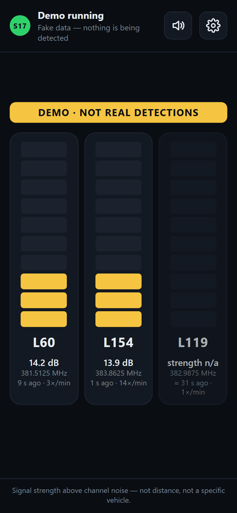
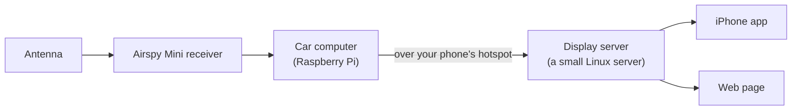

# Slot17

Slot17 is a research tool that recognises TETRA radio bursts by the public training pattern that the ETSI standard (EN 300 392-2) puts inside every burst. A small computer with a radio receiver, for example in a car, listens to the band, and a phone or web page shows what it hears, with signal bars and an optional sound.

TETRA is a digital radio standard. In many countries emergency services are among its users.

**Slot17 is not a police or emergency-vehicle detector, and it is not a product.** It shows that a radio transmitted and how strong the signal was; nothing more. See [LEGAL.md](LEGAL.md) before you build or use it.

> **What a match means:** a TETRA radio transmitted and the receiver heard it. A match does **not** identify police, an ambulance, a radio or a vehicle, and it does not measure distance. A vehicle whose radio is silent is invisible. Radios in buildings, parked cars or carried on foot look the same as one coming towards you. [TETRA-SIGNALS.md](docs/design/TETRA-SIGNALS.md) explains why.

It only receives. It never transmits, and it never decodes, decrypts or listens to what anyone says.

**Status:** it works in daily drives, but how far away it reliably hears a radio has not been measured. See [Limits](#limits).

**Questions?** The [FAQ](docs/FAQ.md) answers the common ones: range, false beeps, which receiver, which countries, hosted servers and the apps. For help or ideas, join the [Slot17 Discord](https://discord.gg/rSFPWSWNfh). The website is [slot17.cloud](https://slot17.cloud).

<table>
<tr>
<td align="center" width="33%"><br>The app</td>
<td align="center" width="33%"><br>On CarPlay</td>
<td align="center" width="33%"><br>The web page</td>
</tr>
</table>

These show demo data. More pictures are in [SCREENSHOTS.md](docs/SCREENSHOTS.md).

## Contents

1. [How it works](#how-it-works)
2. [Does it work in my country?](#does-it-work-in-my-country)
3. [What you need](#what-you-need)
4. [Step 1: Prepare the car computer](#step-1-prepare-the-car-computer)
5. [Step 2: Set up the display server](#step-2-set-up-the-display-server)
6. [Step 3: Set up the car computer](#step-3-set-up-the-car-computer)
7. [Step 4: Install the app](#step-4-install-the-app)
8. [Daily use](#daily-use)
9. [Updating](#updating)
10. [Troubleshooting](#troubleshooting)
11. [Reading a session](#reading-a-session)
12. [Tests](#tests)
13. [Security](#security)
14. [Limits](#limits)
15. [Repository layout](#repository-layout)
16. [Community](#community)
17. [License](#license)

## How it works



1. The **antenna and receiver** pick up the radio band TETRA uses.
2. The **car computer** looks for the fixed training pattern in the middle of every TETRA burst, four times a second, on all 200 channels of 380–385 MHz. It runs by itself from the moment the car powers it.
3. It sends what it hears through your **phone's hotspot** to a **display server** on the internet.
4. The **iPhone app** or **web page** shows the signal bars and plays a sound for strong signals. You can also mark what you saw from the app, stop the detector, and power off the car computer.

Why a separate server? The car computer sits behind your phone's hotspot, so the phone can't reach it directly. Both can reach a server on the internet. Nothing ever connects to the car computer itself.

## Does it work in my country?

Slot17 recognises **TETRA**. It was built and tested in the **Netherlands**, on the C2000 network. Out of the box it listens to **380–385 MHz**, the band where the radios in vehicles and on people transmit.

| Situation | What to expect |
|---|---|
| Your emergency services use TETRA in 380–385 MHz | This is the setup Slot17 is built for. In Europe this band is set aside for emergency services, and many countries use it, for example Belgium, Germany, the United Kingdom, the Nordic countries and Austria. Only the Netherlands has been tested |
| They use TETRAPOL, as in France and Switzerland | Slot17 won't recognise it. TETRAPOL is a different system |
| They use TETRA on other frequencies, which is common outside Europe | The code has a `--freq` option, but other bands are untested |
| They use other digital radio, such as P25 in the US, DMR, or LTE-based systems | Not supported |

Check which system your country uses before buying anything. Also check the law: receiving this band, or using such equipment in a vehicle, may be restricted where you live.

## What you need

These are the parts we use. Equivalent parts should work too.

| Part | What we use | Alternatives and advice |
|---|---|---|
| **Car computer** | [Raspberry Pi 5](https://www.raspberrypi.com/products/raspberry-pi-5/), 8 GB | Any memory size from 2 GB up should do: the detector uses about 0.6 GB. We have only tested the Raspberry Pi 5; slower computers may not keep up |
| **Storage** | 512 GB NVMe SSD | A good microSD card of 128 GB or more works too. Recordings grow with every drive: ours collected about 155 GB in two months. Recording pauses when less than 5 GB is free |
| **Case** | Argon case with NVMe slot | Any case with cooling. A car gets hot in summer |
| **Power in the car** | USB-C car charger | Use one that gives 5 V at 5 A (27 W) with USB-C Power Delivery. Most USB-C car chargers give only 3 A at 5 V, however many watts they advertise at higher voltages, so check that 5 V 5 A (or 5.1 V 5 A) is listed. A weak charger or a thin cable causes undervoltage, which Slot17 reports |
| **Receiver** | [Airspy Mini](https://itead.cc/product/airspy-mini/) | Its antenna socket is SMA. Other receivers aren't supported |
| **Antenna** | [Motorola GMAE4258B](https://www.firecom.nl/merken/motorola/motorola-gmae4258b/), a hidden TETRA antenna for 380–410 MHz, stuck inside the front windscreen | Any antenna made for 380–400 MHz works. **An antenna on the outside of the car, such as a magnetic roof antenna, receives better** than one inside. Some windscreens have a metal coating that blocks radio signals. You may need an adapter to the Airspy's SMA socket |
| **Internet in the car** | The iPhone's personal hotspot, or a ZTE MF833N 4G USB stick with its own SIM | Any hotspot or car Wi-Fi works and needs nothing extra. A 4G stick spares the phone's battery; ours needs one extra setup command on a Raspberry Pi 5, see [the optional step](#optional-a-4g-stick-instead-of-the-hotspot). A stick that Linux recognises by itself needs no setup at all |
| **Display server** | A hosted server from us, or your own | Ours: one command in the Discord, nothing to rent; see [step 2](#step-2-set-up-the-display-server). Your own: any Debian or Ubuntu machine with a public address that the car and phone can reach, such as a cheap VPS. A home computer works if you forward a port on your router |
| **Phone** | iPhone with iOS 16.2 or newer | An Android phone with Android 8 or newer works too, with its own app. The iPhone's Live Activity and widget need iOS 18, and showing them on CarPlay needs iOS 26. Computers can use the web page |
| **Notifications (optional)** | [Pushover](https://pushover.net) | Only for fault messages, such as "receiver hears nothing". From 1.2.9 the iPhone app can show the same faults itself (Settings, Fault messages) and switch Pushover off and on; the app's notifications work only while the app runs |

You also need a computer to set things up. Windows, macOS and Linux all work.

Not used to Linux? [SETUP-WITH-AI.md](docs/SETUP-WITH-AI.md) has a prompt for any AI chat assistant that then walks you through these steps one at a time and checks each one.

## Step 1: Prepare the car computer

**The easy way: the ready-made image.** Each release has `slot17-VERSION-raspios-lite-arm64.img.xz`: Raspberry Pi OS Lite with Slot17 on it and SSH on. Flash it with [Raspberry Pi Imager](https://www.raspberrypi.com/software/) (**Use custom**, then the file), set a username, password and Wi-Fi in Imager's settings, and write it. Then open the card's **bootfs** drive on your computer, fill in **slot17.txt** (your server address and car computer key from step 2, and your phone's hotspot) and start the Pi with it. It sets itself up in about 5 minutes and then removes the key and the password from the card; if something goes wrong, **slot17-setup.log** on the card says what. Then go on to [step 4](#step-4-install-the-app). [BUILD.md](docs/BUILD.md) walks through the whole build, hardware included.

The steps below do the same by hand.

**1. Put an operating system on its storage.**
1. Install [Raspberry Pi Imager](https://www.raspberrypi.com/software/) on your computer and open it.
2. Choose your Raspberry Pi model, then **Raspberry Pi OS (other) > Raspberry Pi OS Lite (64-bit)**, then your microSD card or SSD.
3. When it offers to customise the settings, choose **Edit settings** and fill in:
   - **Hostname:** for example `slot17`.
   - **Username and password:** remember these.
   - **Wireless LAN:** your **phone's hotspot name and password**, so it gets internet in the car. You can add your home Wi-Fi later.
   - **Wireless LAN country:** your country.
4. On the **Services** tab, turn on **Enable SSH** with password authentication.
5. Write the image.

On an iPhone, the hotspot is under **Settings > Personal Hotspot**. Turn on **Maximise Compatibility** if the computer can't find it.

**2. Connect the hardware.**
1. Plug the antenna into the Airspy Mini.
2. Plug the Airspy into a blue **USB 3** port on the Raspberry Pi.
3. Insert the storage and connect the power.

**3. Log in to it from your computer.**
1. Turn on your phone's hotspot, and connect your computer to the same hotspot.
2. Wait about two minutes after power-up.
3. Open **PowerShell** on Windows or **Terminal** on a Mac, and type, using your username and hostname:

```bash
ssh yourname@slot17.local
```

The first time, type `yes` to trust it, then your password. You now control the car computer.

**4. Optional: add your home Wi-Fi**, so you can work on it at home. Replace the name and password with yours:

```bash
sudo nmcli device wifi connect "Your home Wi-Fi" password "your-wifi-password"
```

## Step 2: Set up the display server

Do this first, because it gives you the address and key that the car computer needs. There are two ways: a server we host for you, or your own.

### Option A: a hosted server from us

1. **Join the [Slot17 Discord](https://discord.gg/rSFPWSWNfh).**
2. **Type `/server create`** in any channel. The bot answers in a message only you can see, with:
   - your **private link**, for the app and the web page;
   - your **server address**, such as `https://k7f2q.slot17.cloud`, and your **car computer key**, for the next step.
3. **Copy them somewhere safe.** They aren't shown again. Anyone with the private link can see your car's data and stop the detector.

The server is linked to your Discord account. Other commands, again only visible to you:

| Command | What it does |
|---|---|
| `/server info` | Your server's address, whether it runs, when your car computer last sent something, the detector's state and what is stored |
| `/server new-keys` | New keys; the old link and car computer key stop working |
| `/server delete` | Deletes your server and everything on it. The address is never handed out again |

Each hosted server is a separate copy with its own address, keys and folder; other people's servers can't reach it. What it stores and who can see it: [slot17.cloud/privacy.html](https://slot17.cloud/privacy.html). Then go on to [step 3](#step-3-set-up-the-car-computer).

### Option B: your own server

1. **Log in to your server** with the details from your hosting provider, for example `ssh root@203.0.113.5`.
2. **Use a normal user, not root.** If the provider only gave you root, create a user first:

```bash
adduser yourname
usermod -aG sudo yourname
su - yourname
```

3. **Run the installer** and wait for it to finish:

```bash
curl -fsSL https://github.com/efeorman/Slot17/releases/latest/download/install.sh | bash -s -- server
```

At the end it prints three things. **Copy them somewhere safe:**

| What it prints | What it's for |
|---|---|
| Your **private link** | Opens the web page and connects the app. Treat it like a password, because anyone with it can also stop the detector and power off the car computer |
| The **server address** and **car computer key** | For the next step |
| An **on/off link** | Optional, for a phone shortcut that tells you whether the car computer is running |

You can print them again at any time with `bash ~/Slot17/setup.sh server --show`.

The address it prints is the server's public internet address, which it looks up for you. If that's wrong, for example behind a router, give the right one: `bash ~/Slot17/setup.sh server --address 203.0.113.5`.

**The server must be reachable from the internet on port 5732.** The installer opens that port in `ufw` if it's in use, but many hosting providers also have their own firewall in their web dashboard; allow incoming TCP on port 5732 there. To test, open `http://YOUR-SERVER-ADDRESS:5732/healthz` on your phone with Wi-Fi **off**: it should say `ok`.

## Step 3: Set up the car computer

On the car computer (logged in as in step 1), run:

```bash
curl -fsSL https://github.com/efeorman/Slot17/releases/latest/download/install.sh | bash -s -- car
```

It installs everything and runs about 90 checks. Then it asks a few questions, and explains each one:

| Question | Our advice |
|---|---|
| Connect to a display server? | **Yes.** Paste the server address and the car computer key from step 2 |
| Set up Pushover notifications? | Optional. You need a Pushover app token and user key |
| Calibrate the receiver? | **Yes**, once, with the antenna connected. It measures how far your receiver's frequency is off, which differs per receiver |
| Start it now? | **Yes** |

From now on the detector **starts by itself every time the car computer gets power**. You don't need to log in again for normal use.

To see what is installed, without changing anything:

```bash
bash ~/Slot17/setup.sh car --check
```

### Optional: a 4G stick instead of the hotspot

A 4G USB stick with its own SIM gives the car computer internet without your phone. The hotspot stays as the fallback: the car computer uses a wired network first, then the stick, then Wi-Fi.

We use a **ZTE MF833N**. A Raspberry Pi 5 can't use that stick as it comes, so it needs one more command, with the stick plugged in and the detector stopped:

```bash
bash ~/Slot17/setup.sh modem
```

It installs a USB fix made by someone else and a small check of ours that keeps the stick connected. [MOBILE-MODEM.md](docs/operations/MOBILE-MODEM.md) explains both, what was tested, and what to know about other sticks.

- **Plug the stick into the other pair of USB sockets**, not the pair the receiver is in. On the same pair, the receiver lost samples while the stick started, on three of four starts.
- **Leave the hotspot switched on for the first drives.** On our first drive the stick lost its mobile connection once for eight minutes, and with no hotspot the phone had nothing from the car for that time.

## Step 4: Install the app

There is an app for iPhone and one for Android. Without either, open your private link in any browser and tap **Start**.

### iPhone

Apple only allows App Store apps to be installed normally, and Slot17 isn't in the App Store, so you sign it yourself.

1. **Download the app file.** On the [latest release](https://github.com/efeorman/Slot17/releases/latest), download **Slot17.ipa**.
2. **Sign and install it** with one of these:

| Option | Cost | How long it keeps working | How |
|---|---|---|---|
| **[Signulous](https://www.signulous.com)** | $19.99 a year per iPhone | A year | Register your iPhone on [signulous.com/register](https://www.signulous.com/register), ideally by opening that page in Safari on the iPhone and choosing **Link this device**. Install the profile it gives you. Then upload **Slot17.ipa** with Signulous's own-app signing and install it, following their current instructions |
| **[Sideloadly](https://sideloadly.io)** | Free, with a normal Apple ID | 7 days, then you install it again | Install Sideloadly on Windows or a Mac, connect the iPhone with a cable, drag **Slot17.ipa** onto Sideloadly, sign in with your Apple ID and press **Start**. Then allow your Apple ID under **Settings > General > VPN & Device Management** |

We used Sideloadly at first and use Signulous now (since app 1.5.1). With Signulous the sighting widget's App Group gets a name of Signulous's own; the app finds it by itself. Signing services like it depend on Apple's certificates, which Apple can revoke.

3. **On iOS 16 and newer, turn on Developer Mode** if the iPhone asks: **Settings > Privacy & Security > Developer Mode**, then restart.
4. **Open Slot17 and paste your private link** from step 2. It's stored in the iPhone's Keychain.

### Android

1. **Download the app file.** On the [latest release](https://github.com/efeorman/Slot17/releases/latest), open **Slot17.apk** on the phone.
2. **Install it.** Android asks once whether your browser or file manager may install apps; allow it for this one install. The app is signed with our own key, so later versions install over it and keep your settings.
3. **Open Slot17 and paste your private link** from step 2.
4. **Allow notifications, then in Settings tap Let Slot17 run in the background.** It keeps a notification while it listens, which lets it play the beeps with the screen off. Some phones (Samsung, Xiaomi, Huawei) also need battery optimisation turned off for Slot17 in the phone's own settings.

It does the same as the iPhone app; [android/README.md](android/README.md) lists where it differs (a notification instead of the Live Activity, Quick Settings tiles instead of Control Center controls).

**In Android Auto** an urgent beep also shows as a message from Slot17, which Android Auto reads out; say "police", "ambulance", "fire" or "nothing" to mark what you saw. Because the app isn't from Google Play, Android Auto only shows these with **Unknown sources** on: in the Android Auto settings on your phone, tap **Version** 10 times, open **Developer settings** from the menu and tick **Unknown sources**. To switch the messages off: the app's **Settings > Android Auto**.

## Daily use

1. **Start the car.** The car computer powers up, joins your phone's hotspot and starts listening by itself. Keep your hotspot on.
2. **Open the Slot17 app once, then lock the phone.** iOS doesn't let an app start sound from the background, so opening it is what arms the sound. On CarPlay you hear it through the car, and a Live Activity shows the status. On Android the app keeps a notification while it runs and the sound follows the phone's audio, over Bluetooth or Android Auto.
3. **Strong signals give a sound:** a chime at 35 dB above the background, and an urgent beep at 50 dB. These are signal strengths, not distances.
   - **A radio in a call** (normal bursts on every TETRA frame, which is what speech or a data call looks like) gets a soft, lower two-note tone from 18 dB, below the chime level. It is traffic on that channel; it says nothing about who or how far.
   - The meters also say **Rising** when a channel's newest match is at least 6 dB above the weakest of the last minute and the strongest so far. Louder is not nearer: a radio sets its power by its own mast.
4. **If you have a passenger, mark what you see** with **I SAW** in the app, including vehicles that gave no alert. That is the only way to learn what Slot17 misses.
5. **Park and switch off.** Cutting the power is fine; [POWER-LOSS.md](docs/operations/POWER-LOSS.md) explains what that keeps.

The app's **Pi** screen can stop the detector or power off the car computer. It can't start the detector again, on purpose: starting stays with the next power-up.

## Updating

Run the same line as in step 2 or 3 again. It downloads the latest release and keeps your keys, settings, calibration and recordings.

On the car computer, stop the detector first:

```bash
sudo systemctl stop tetra-detector.service
curl -fsSL https://github.com/efeorman/Slot17/releases/latest/download/install.sh | bash -s -- car
```

To update the iPhone app, download the new **Slot17.ipa** and install it the same way as before. The Android app updates itself: **Settings > About > Download and install**, and Android asks you to confirm.

**You hear about updates by yourself.** Every 6 hours the display server asks GitHub which Slot17 release is the newest (only the public release page is asked for; nothing about your server or car is sent). The app then says so in **Settings > About** for a new app, and on the **Pi** screen for new car computer software; the web page says it at the bottom. If you allowed the app's fault notifications, you also get one notification per new version. To turn the check off, set `"release_check": false` in the server's `config.json`; a fork can point it at its own repository with `"release_repo": "owner/name"`.

### Updates by themselves

From 1.3.1 the car computer can install new versions by itself, at its next start, so you don't have to connect to it. The setup asks (say yes, the default) and then puts the Slot17 team's public key on the car computer (`deploy/slot17-release-key.pub` becomes `~/.config/slot17-release-key.pub`). The car computer then takes only software signed with the team's key.

- **Where it comes from:** each release on GitHub carries the signed update (`slot17-update.json` and `slot17-update.tar.gz`). A server set up with 1.3.1 or later copies it into its `release/` folder (`"release_updates": true` in its `config.json`; set it to `false` to stop that), and so does a hosted server. An older server you set up yourself needs that line added.
- **How it works:** the car computer asks the server at each start (if it already has a network) and a few times during a drive. The car computer asks the server for it at each start (if it already has a network) and a few times during a drive. It checks the signature, tests the complete new software in a copy, and only then replaces the files, before the receiver is opened.
- **What it protects against:** the server holds no signing key, so neither the server nor anyone on the network can supply software. An older release is refused. A release that fails its tests is rejected and the installed software stays. A power cut during the replacement is finished at the next start.
- **What it replaces:** `p0/`, `tests/` and `display/display_publisher.py`. Never your calibration or channel files, and never the service files.
- **Where you see it:** the app's Pi screen shows the installed version, and the Live Activity says "Updated to …" for a few minutes after an update, or that one failed.

Turn it off with `bash setup.sh car --no-updates`. With your own fork, put your own public key there instead (64 hex characters, Ed25519) and sign your releases yourself; `p0/update.py` describes the format (`manifest.json` plus the files in a signed tar.gz, described by `release.json`).

### Slower and faster computers

The detector checks candidates on several threads at once and chooses how many from the computer it runs on, leaving one core free for the receiver:

| Cores | Checking threads |
|---|---|
| 1 or 2 | 1 |
| 3 | 2 |
| 4 (Raspberry Pi 4 and 5) | 3 |
| 5 or more | 4 |

It prints its choice at start, and `confirm_workers` in the heartbeat shows what the last window used. You don't have to set anything. To choose yourself, add `--check-threads N` to the end of the `ExecStart` line of `tetra-detector.service` (after `--save-power`), or set the environment variable `SLOT17_CHECK_THREADS`:

```bash
sudo systemctl edit tetra-detector.service
```

```ini
[Service]
Environment=SLOT17_CHECK_THREADS=2
```

- **Fewer threads cost nothing in correctness.** What doesn't fit in a window's time is recorded as unchecked. Fewer threads only mean more candidates unchecked when the band is busy or full of interference.
- **Checking is cheaper since 1.2.6.** Cutting one channel out of the band now takes two short filter stages instead of one long one, which halves the time of a check on a PC with exactly the same results; the recogniser tries 8 symbol timings instead of 4, which finds more weak bursts.
- **Interference bursts are checked last.** When one burst of interference lights up many channels at once, those candidates are checked after all the others, in whatever is left of the window's time. The ones not reached are recorded as unchecked.
- **A channel recognised in the last minute is checked first**, interference or not.
- **If the receiver drops samples**, checking goes back to one thread by itself. After five minutes with no further loss the threads come back, once; if samples are lost again after that, it stays on one thread until the detector stops.
- **Except in the first minute.** Samples lost in the stream's first 60 s (while a 4G stick on the same USB controller starts, in our car) are counted as `startup_dropped`, don't mark the session degraded and leave the threads alone. Set `SLOT17_STARTUP_GRACE_S` to change the 60 s; 0 treats every loss as a fault.
- **Tested:** a four-core Raspberry Pi 5, where three threads check 2.2 times as much as one. More than four threads, and computers with one or two cores, have not been measured by us.

## Troubleshooting

| Problem | What to do |
|---|---|
| `ssh: Could not resolve hostname slot17.local` | Your computer and the car computer must be on the same network. Wait two minutes after power-up. On older Windows, try the address shown in your phone's hotspot screen instead |
| You don't know where to start | On the car computer, run `bash ~/Slot17/setup.sh doctor`. It only looks, changes nothing, and gives one verdict per part: receiver, service, detector, network, clock, server, power, storage, settings. The first problem it lists is usually the cause of the others. On the server, `bash ~/Slot17/setup.sh doctor server` |
| The app says **No data from the car** | Is the hotspot on, and did the car computer join it? Is port 5732 open on the server? On the car computer, `bash ~/Slot17/setup.sh car --check` shows what is set up |
| The phone can't open the private link | The server's port 5732 isn't reachable from the internet. Open it in your hosting provider's firewall, and check the address with `bash ~/Slot17/setup.sh server --show` |
| **Receiver input very low** | The receiver hears almost nothing. Check that the antenna is screwed in. A quiet place can also cause it, and indoors this message is normal |
| The detector didn't start | Read why with `journalctl -u tetra-detector.service -n 40 --no-pager`. **Don't keep restarting it**: if the Airspy stopped responding, unplug it, plug it back in, and power-cycle the computer |
| The 4G stick's light is red, or the app has no data while the stick is in | The stick has no mobile connection. Slot17 asks it to reconnect every 30 seconds and says what the stick reported: `journalctl -u slot17-modem.service -b \| grep modem:`. If the light stays red for minutes with good coverage, pull the stick out and put it back; with a hotspot switched on, the car computer uses that meanwhile |
| The app feels slow, or you want to know which network the car computer is on | Open the app's **Pi** screen, card **Connection**: the phone's round trip to the server, the network the car computer uses (4G stick, hotspot or cable) and its upload times over the last minute, and for the stick its signal (RSRP; from -90 dBm is good, under -105 weak), quality, its own ping to the server and whether data roaming is on. Needs release 9 on the car computer and app 1.4.9 |
| **Undervoltage** or **throttling** warnings | The power supply or cooling is too weak. Use a 5 V 5 A charger and a cooled case |
| No sound on the iPhone | Open the app again, because iOS needs that to start the sound. Check the volume and **Settings > Sound** in the app. The app's Logs screen says why each alert did or didn't make a sound |
| Calibration found no carriers | Your country may not use 390–395 MHz for the base stations, or the antenna isn't connected. Slot17 still runs, using an example calibration |
| The storage is full | Old recordings are never deleted automatically. Delete old folders in `~/Slot17/captures/` |

## Reading a session

Each detector run gets a folder in `~/Slot17/captures/`. **The folder name uses the clock from before the car computer had internet, so it's often wrong.** The car computer has no battery-backed clock, so use `corrected_start_utc` in `session-time.json` instead.

| File | What it holds |
|---|---|
| `session.json` | Settings, software versions and file fingerprints |
| `session-time.json` | The corrected start time |
| `events.jsonl` | Everything that happened: candidates, decisions, signal and computer health, your marks, failures |
| `recordings.jsonl` | Whether each recording was really saved |
| `w…-ch….c64` and `.json` | Short recordings of the bursts heard, which can be replayed |
| `summary.json` | Totals and errors, rewritten every 30 s. `"final": false` means the power was cut |

**What `confirmed` means in `events.jsonl`:**

| Value | Meaning |
|---|---|
| `true` | The TETRA training pattern was recognised |
| `false` | It wasn't found in the parts tested; see `confirmation_coverage` |
| `null` | Not checked, or an error |

A match also says which rule made it, in `matched_burst.rule`: `standard`, or `weak` for a burst too noisy for the standard modulation limit whose training pattern still fits (a stricter fit is asked of the noisiest ones), or since 1.2.7 `coherent` for a burst whose training pattern fits the word's own symbols though the step-by-step test refused it. Every inspected burst also records its `coherent_correlation`. How false matches are prevented and tested is in [FALSE-MATCHES.md](docs/design/FALSE-MATCHES.md). Weak matches are usually far below any beep level; they show on the meter and in the records.

Since 1.2.6 every match also says `band_edge`: true for channels 0–2 and 196–199, the outermost 25 kHz of the receiver's 5 MHz, examined only since 1.2.6. A strong signal just outside 380–385 MHz could in principle fold onto them, so they can be counted apart.

Since 1.2.5 a match also carries `matched_burst.carrier_hz`: the burst's carrier offset measured over the whole burst, and `carrier_noise_hz`, its uncertainty. From about 15 dB it is good to 0.3 to 2 Hz, where the older `residual_offset_hz` (training pattern only) scatters by tens of Hz. It is a record for research and decides nothing. Our receiver's own frequency drifts by 37 to 124 Hz over a drive, so compare values within minutes, not between drives.

Most unchecked candidates are one short burst of interference seen on every channel at once. `unchecked_own_burst` in the heartbeat and `summary.json` counts the ones that matter: candidates holding a burst at a moment of their own that was never looked at. It should stay at or near zero.

**The car computer's log.** It loses power with the ignition, so it can't send a log when a drive ends. The server asks it for one two minutes into a drive and every ten minutes after, and keeps them next to the app's logs (`pi-….log`).

To replay a recording on a computer that isn't capturing:

```bash
python -B p0/examine.py captures/SESSION_FOLDER/w00000001-ch104.c64
```

### The drive report

When the app sends a drive's data to the server (by itself, a few minutes after the car stops, or by hand), the server writes a report beside it: matches and sounds, the delay from burst to phone, your sightings with what was heard around them, speed, and from the car computer's logs the session's counters, the noise floor, how the uploads went and the 4G stick's signal. It is in the app under **Logs**, as `report-…`, and in the server's `logs` folder.

### Did the beeps help? The scorecard

The app uploads each drive's matches, beeps, sightings and route to the server. The scorecard reads those uploads and shows how many of the emergency vehicles you marked had a beep before them, how many didn't, and how many beeps had no vehicle:

```bash
python scripts/scorecard.py path/to/the/servers/logs --out SCORECARD.md
```

It also shows how often an ordinary moment has a beep before it. If that number is close to the number for your sightings, the beeps aren't telling you anything. **Only sightings marked independently of the beeps count**, so have a passenger mark every emergency vehicle they see, beep or not. A mark made because a beep made you look proves nothing. Test taps can be left out with `--exclude 2026-11-11T19:54:04Z`.

### Getting more out of the antenna

Every dB the band's quiet level rises is a dB of reach lost, and in a car it is usually the car's own electronics that raise it. The app's Pi screen shows two figures for this:

- **Noise floor:** the quiet level now, and how far it is above your receiver alone. To get the second part, read the floor once at home with the antenna hearing nothing, and put that number in the server's `app-config.json` as `"floor_quiet_db"` under `"display"`.
- **Interference, last minute:** the share of the detector's windows in which the whole band lit up at once.

Parked with the ignition on, change one thing, wait a minute and read the floor: move the antenna away from the car computer, the phone and the chargers; unplug a charger; add ferrites to the receiver's USB lead and the power lead. What lowers the number is worth keeping.

## Tests

Everything below runs on any computer with Python 3.10 or newer, without a receiver. The tests use saved and generated signals and fake hardware. They never open a receiver or send a real message.

```bash
git clone https://github.com/efeorman/Slot17.git
cd Slot17
python -m venv .venv
source .venv/bin/activate      # on Windows: .venv\Scripts\activate
pip install -r requirements-dev.txt
python -B p0/preflight.py --offline --tests
```

You should see `OK` and `"offline_preflight_pass": true`.

| Command | What it covers |
|---|---|
| `python -B p0/preflight.py --offline --tests` | The detector: 175 tests. Before every detector start the car computer runs them only if its code changed since they last passed, and in any case every 20th start; otherwise a smoke test of a few seconds (`--tests-if-changed`) |
| `python -m unittest display/test_hardening.py` | Server and car computer limits |
| `python -m unittest display/test_app_backend.py` | What the app uses on the server |
| `python -m unittest display/test_display.py` | Display logic |
| `python -m unittest scripts/test_scorecard.py` | The scorecard |
| `python -m unittest scripts/test_modem_link.py` | The 4G stick check, with a pretend stick |
| `python -m unittest scripts/test_doctor.py` | `setup.sh doctor`, with a pretend machine |
| `python -m unittest display/test_drive_report.py` | The drive report |
| `python -m unittest display/test_display_browser.py` | The web page in a headless browser; needs `pip install playwright` and `playwright install chromium` |
| `python display/stress_server.py` | Attacks and load on a local copy of the server |
| `bash scripts/test_setup.sh full` | The whole installation, on a **throwaway** Linux machine, because it installs real services |
| `ruff check p0 display deploy tests scripts` | Code style and common mistakes |

The iPhone tests need a Mac, so they run in the cloud; see [ios/README.md](ios/README.md). More detail is in [TESTING.md](docs/operations/TESTING.md).

## Security

Read [SECURITY.md](SECURITY.md) before relying on this. The main points:

- **No encryption:** the server uses plain HTTP, so someone who can watch your connection could read your private link and use it.
- **One key does everything:** your private link can view everything, stop the detector and power off the car computer.
- **The car computer accepts no incoming connections** for Slot17. It collects the phone's requests from the server, and knows only these: stop the detector, power off, save a recording, send its log, and switch its Pushover messages off or on. None of them can start the receiver.

## Limits

- **No identity or distance.** See the note at the top.
- **Range unknown.** How far away it reliably hears a radio hasn't been measured. A proper test needs independent sightings; see [FIELD-TEST.md](docs/operations/FIELD-TEST.md).
- **The receiver can hang.** An Airspy can stop responding after being started and stopped many times, and then only unplugging it helps. Slot17 therefore never restarts it automatically.
- **iOS decides when the app runs.** iOS sometimes pauses the app for 5–36 seconds in the background, and can end it, after which it stays silent until you open it again.
- **CarPlay shows a Live Activity, not an app.** A CarPlay app needs permission from Apple.
- **Frequency drift.** A receiver's frequency changes with temperature and age. Ours measured +9.6 and later +4.1 ppm. Detection worked at both settings, but recalibrating now and then does no harm.

## Repository layout

| Folder | What's in it |
|---|---|
| [install.sh](install.sh), [setup.sh](setup.sh) | The installer and the setup |
| [p0/](p0) | The detector: capture, channels, burst detection, training-pattern recognition, recording, health |
| [display/](display) | The car computer's link to the server, the server, the web page and their tests |
| [deploy/](deploy) | Setup scripts, service files, permission rules and `doctor.py` (`bash setup.sh doctor`) |
| [ios/](ios) | The iPhone app, with its Live Activity and widget |
| [android/](android) | The Android app, with its notification, widget and Quick Settings tiles |
| [shared/](shared) | Test cases both apps must pass in the same way |
| [tests/](tests) | Detector tests and small saved signals |
| [scripts/](scripts) | Release, test and documentation tools |
| [docs/FAQ.md](docs/FAQ.md) | Questions we get a lot, with short answers |
| [docs/BUILD.md](docs/BUILD.md) | Building it into your car, from the parts to the first drive |
| [docs/CHANGELOG.md](docs/CHANGELOG.md) | What changed in each release, why, and what was tried and left out |
| [docs/](docs) | How it works ([design](docs/design)) and how to test and debug it ([operations](docs/operations)) |

To work on the code, read [CONTRIBUTING.md](CONTRIBUTING.md).

## Community

Read the [FAQ](docs/FAQ.md) first, then join the [Slot17 Discord](https://discord.gg/rSFPWSWNfh) to ask questions, get help with your setup, share how it works in your country, or suggest ideas. Bugs can also go in [GitHub issues](https://github.com/efeorman/Slot17/issues).

## License

Slot17 is released under the [PolyForm Noncommercial License 1.0.0](LICENSE). You may use, change and share it for any **noncommercial** purpose: personal use, research, study, hobby projects, and use by charities, schools and public bodies. Commercial use, such as selling it, building it into a paid product or service, or using it in a business, is not allowed under this licence. This is source-available software, not "open source" in the OSI sense.

The licence covers the author's own rights only. It says nothing about other people's rights, such as patents; read [LEGAL.md](LEGAL.md).
