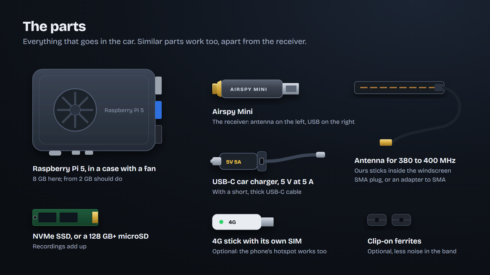
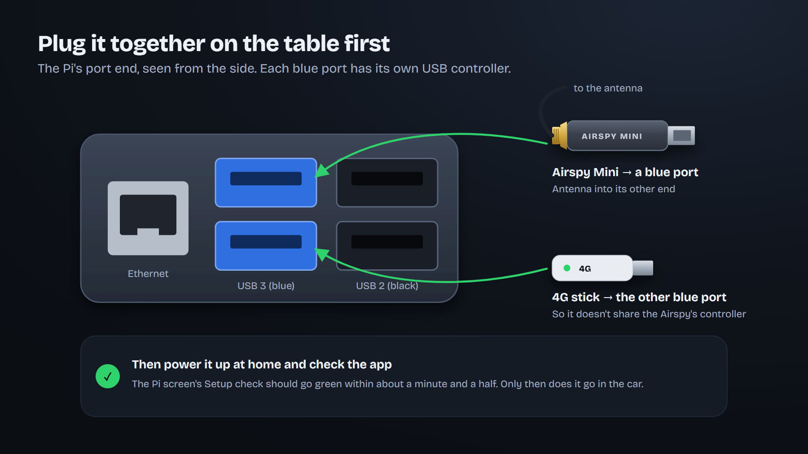
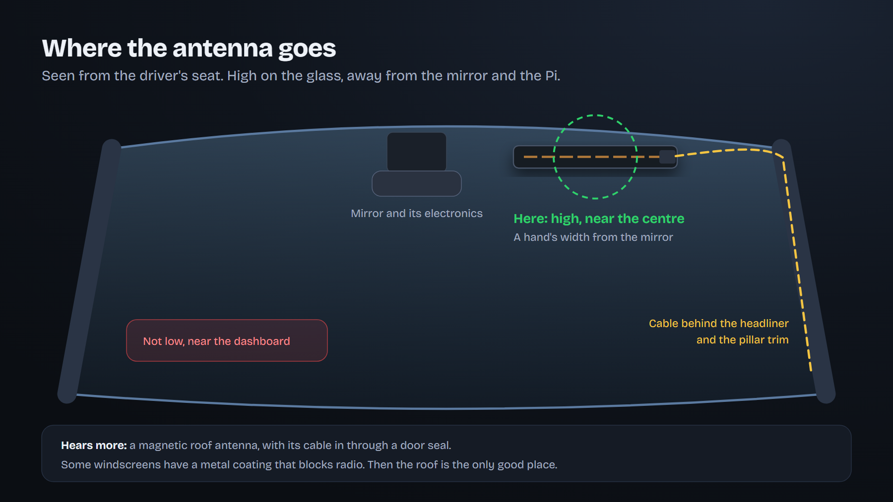
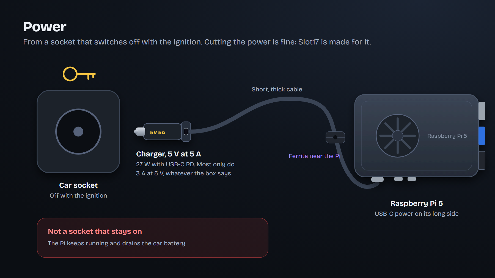
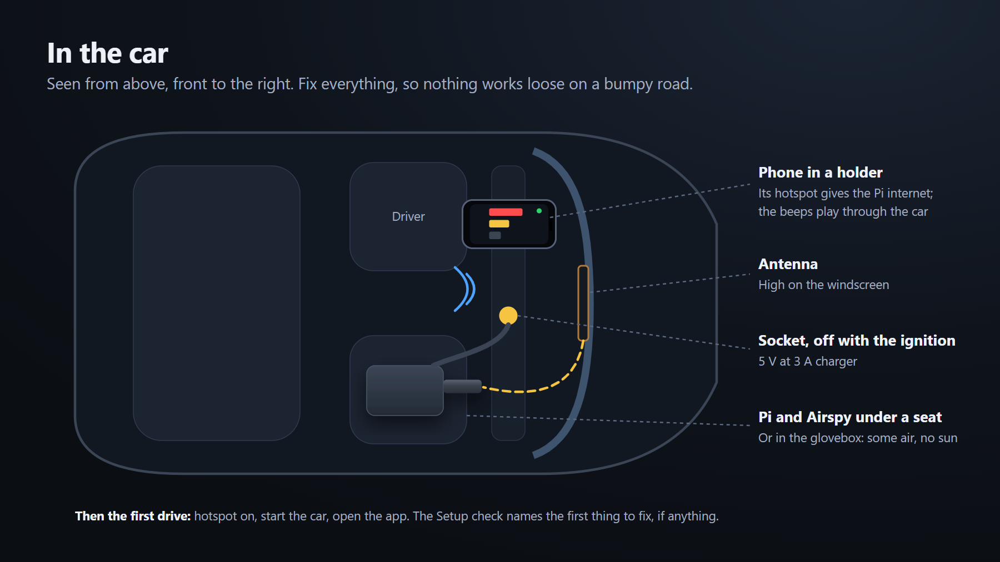

# Building it into your car

From a box of parts to a car computer that beeps on the first drive. It takes an evening. The software side is in the [README](../README.md); this page is about the hardware and where it goes in the car.

<!-- The pictures are drawings (docs/images/build/src/illustrations.html; render with website/scripts/render_build_images.mjs). Photos of real builds are welcome in the Discord. -->

## 1. What you need on the table

- Raspberry Pi 5 (we use 8 GB), in a case with cooling. We use an Argon case with an NVMe slot.
- Storage: an NVMe SSD in that case, or a good microSD card of 128 GB or more.
- Airspy Mini and its USB cable.
- An antenna for 380 to 400 MHz, plus an adapter to SMA if its plug is different.
- A good USB-C car charger. We use the [UGREEN Nexode 60 W (EC602)](https://www.amazon.nl/dp/B0DSBSBSGW), with the Pi on its built-in cable; see [Power](#5-power).

Where to buy each part in your country, with prices and a total: [slot17.cloud/parts/](https://slot17.cloud/parts/).
- Optional: a 4G USB stick with its own SIM, and a few clip-on ferrites (the "noise caps" for cables).

## 2. Put it together on the table first

1. Fit the SSD in the case (or put the microSD card in), and close the case.
2. Plug the antenna into the Airspy Mini, then the Airspy into a **blue USB 3 port** on the Pi.
3. With a 4G stick: put it in the **other blue port**. Each blue port has its own USB controller; a stick starting up on the same one as the Airspy can cost a few samples in the first minute.
4. Flash the storage (step 3 below) and power the Pi from a normal USB-C supply at home first. Check in the app that it says **Detector running** before anything goes into the car.

## 3. The software, the easy way

Use the ready-made image from the [latest release](https://github.com/efeorman/Slot17/releases/latest) (`slot17-…-raspios-lite-arm64.img.xz`):

1. In [Raspberry Pi Imager](https://www.raspberrypi.com/software/), choose your Raspberry Pi 5, then **Use custom** and pick the image file, then your card or SSD.
2. When Imager offers to customise settings: set a **username and password**, your **Wi-Fi** (home Wi-Fi is fine for now) and your country. SSH is already on in the image.
3. Write it. Then open the card's **bootfs** drive on your computer, open **slot17.txt** and fill in your server address and car computer key (from `/server create` in the Discord) and your phone's hotspot name and password. Using Bluetooth alone in the car? Leave the hotspot empty: Bluetooth is on by default there. Save it.
4. Put the card in the Pi and power it up. After about 5 minutes the app shows the car computer. If not, open **slot17-setup.log** on the card; it says what went wrong.
5. In the app, set up Bluetooth: Settings, **Bluetooth to the car computer**, **Set up**, with the car computer nearby. The app then also works in the car without internet ([README](../README.md#optional-bluetooth-to-the-app)).

Prefer to do it by hand? The [README](../README.md#step-1-prepare-the-car-computer) has every step.

## 4. Where the antenna goes

- **On the roof hears the most.** A magnetic roof antenna for 380 to 400 MHz is the easy option; run its cable in through a door seal.
- **Behind the windscreen works too**, which is what we use (a Motorola GMAE4258B stuck to the glass). Keep it high and away from the mirror's electronics. Some windscreens have a metal coating that blocks radio; then the roof is the only good place.
- Keep the antenna and its cable away from the Pi, the phone and the chargers: they make noise in the band.
- More range also means more beeps for radios you can't see. That's normal for TETRA; see the [FAQ](FAQ.md).

## 5. Power

- Use a socket that **switches off with the ignition**. Slot17 is made for its power being cut: it starts by itself every time it gets power, and cutting it is safe ([POWER-LOSS.md](operations/POWER-LOSS.md)).
- A socket that stays on drains the car battery: the Pi keeps running.
- Our charger, the UGREEN Nexode 60 W, gives 3 A at 5 V. That was enough for our Pi with the Airspy, an SSD and a 4G stick. Put the Pi on its built-in cable and nothing else on the same charger.
- A weak charger or a thin cable gives undervoltage; the app's Pi screen and `setup.sh doctor` report it. If yours does, your setup needs more than 3 A: use a 12 V to 5 V converter rated for 5 A and add `PSU_MAX_CURRENT=5000` with `sudo rpi-eeprom-config --edit` ([README](../README.md#what-you-need)).

## 6. Mounting and cables

- Put the Pi where it gets some air and no direct sun, for example under a seat or in the glovebox. Cars get hot in summer; the case's fan helps.
- Fix the Airspy so its USB plug can't work loose on bumpy roads. A loose plug is the most common cause of "receiver hears nothing".
- Clip a ferrite on the Airspy's USB cable and on the charger cable, close to the Pi. It lowers the noise the Pi itself puts into the antenna. The [README](../README.md#getting-more-out-of-the-antenna) explains how to compare before and after.

## 7. The first drive

1. Turn on your phone's hotspot (not needed with Bluetooth), start the car, open the app once and lock the phone (iPhone), or just start the car (Android).
2. The Pi screen's **Setup check** should be all green after a minute and a half. If not, the first item it names is usually the cause of the rest.
3. Post your setup in the [Discord](https://discord.gg/rSFPWSWNfh); photos help other people a lot.
