# Screenshots

All pictures use demo or test data, never a real drive. Signal strengths are in dB above each channel's own noise, not distances.

## iPhone app

<table>
<tr>
<td align="center" width="33%">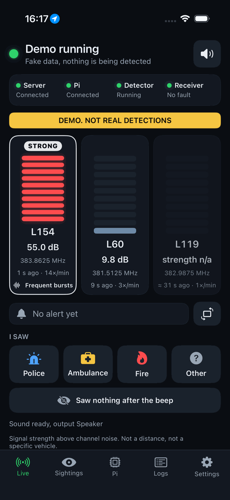 <b>Live</b> Signal bars for the strongest channels, the last alert, and buttons to mark what you saw</td>
<td align="center" width="33%">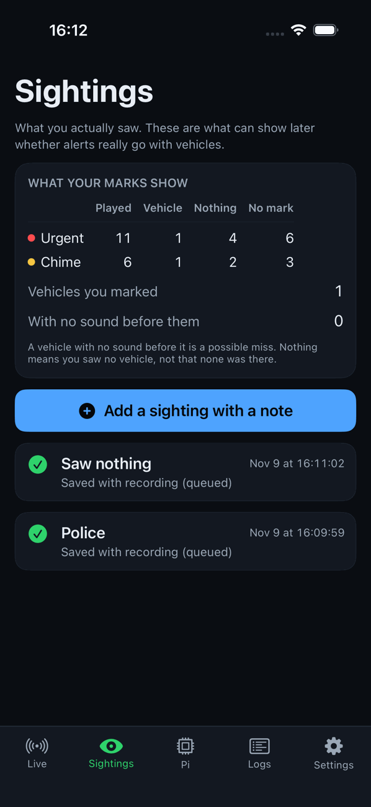 <b>Sightings</b> What you marked, and how your marks compare with the sounds</td>
<td align="center" width="33%">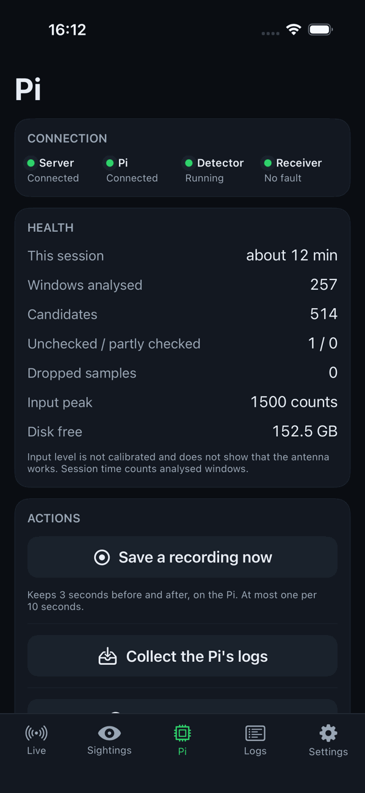 <b>Pi</b> The car computer's health, a recording button, its logs, stop and power off</td>
</tr>
<tr>
<td align="center">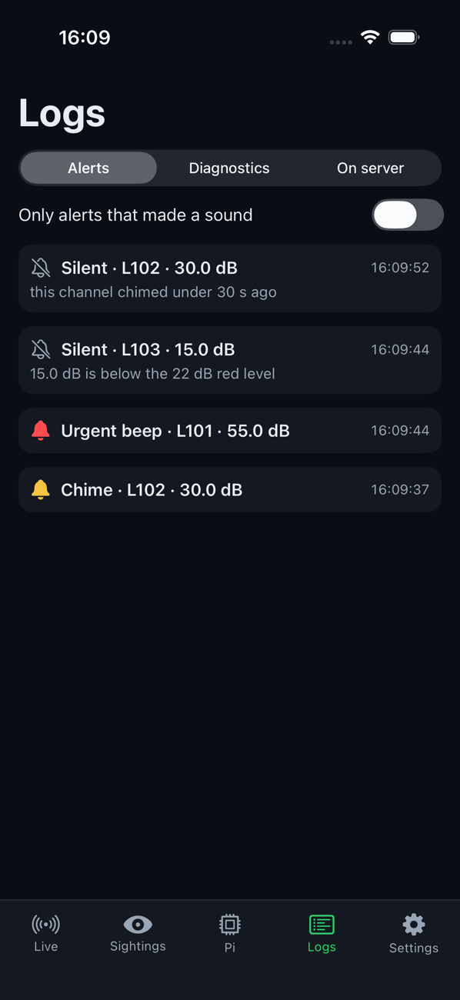 <b>Logs</b> Every alert, and why it did or didn't make a sound</td>
<td align="center">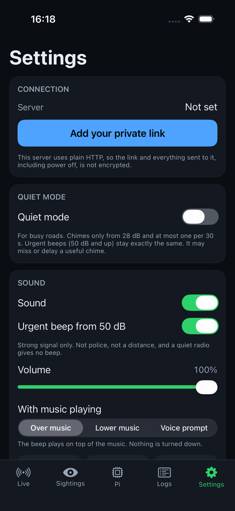 <b>Settings</b> Your private link, quiet mode, sound and levels</td>
<td align="center">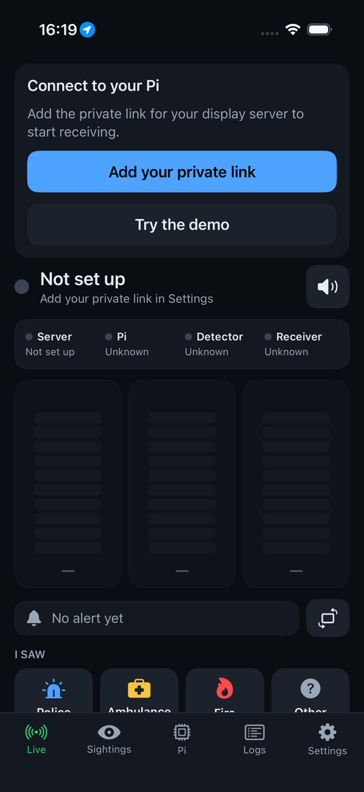 <b>First start</b> Paste your private link, or try the demo first</td>
</tr>
</table>

### Dashboard

Turn the phone sideways for large bars.

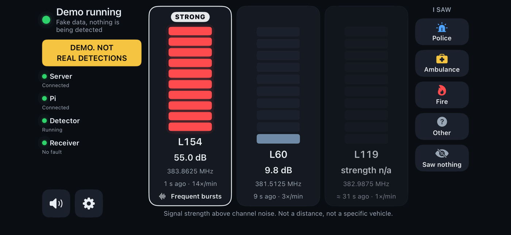

### CarPlay and the lock screen

There's no CarPlay app, because that needs Apple's permission. A Live Activity shows the latest status on CarPlay and the lock screen, and sounds play through the car.

<table>
<tr>
<td align="center" width="50%">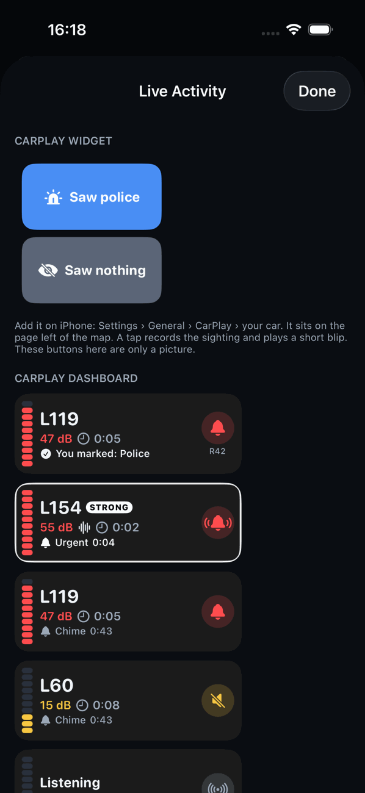 <b>CarPlay</b> The app's preview: the widget's two buttons, and how the Live Activity looks</td>
<td align="center" width="50%">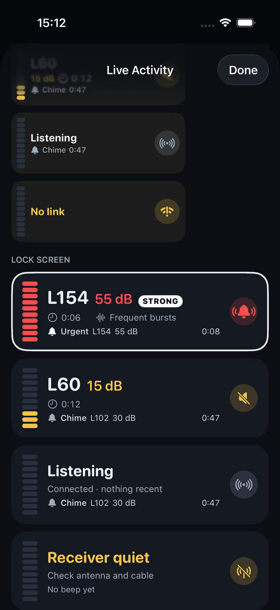 <b>Lock screen</b> The same information while the phone is locked</td>
</tr>
</table>

## Web page

For any phone or computer, through the same private link: the cockpit, with the app's sections.

<table>
<tr>
<td align="center" width="30%">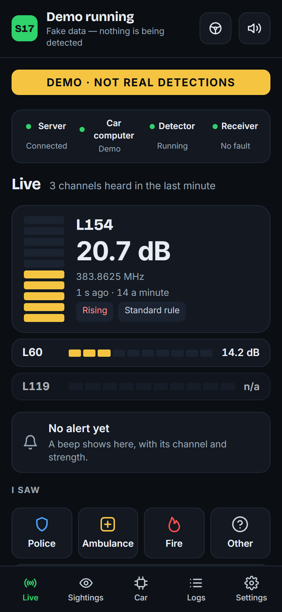 <b>On a phone</b></td>
<td align="center" width="70%">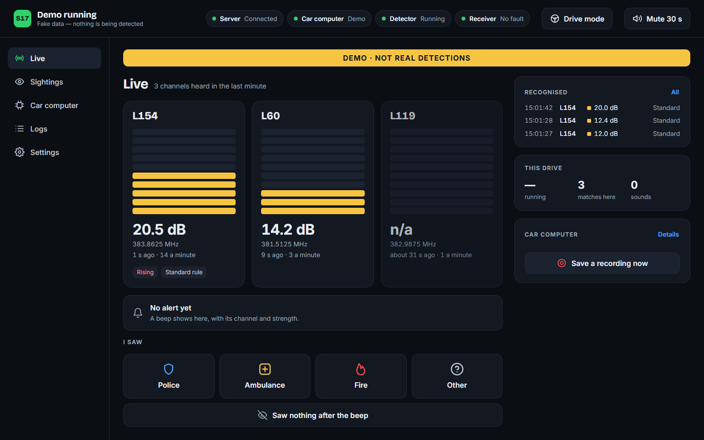 <b>On a computer</b></td>
</tr>
</table>

### Drive mode

One glance on a car mount, and on a screen on the car computer itself: the strongest channel in large figures with its bar, or with **3 bars** the three strongest channels, and large buttons to mark what you saw.

<table>
<tr>
<td align="center" width="55%">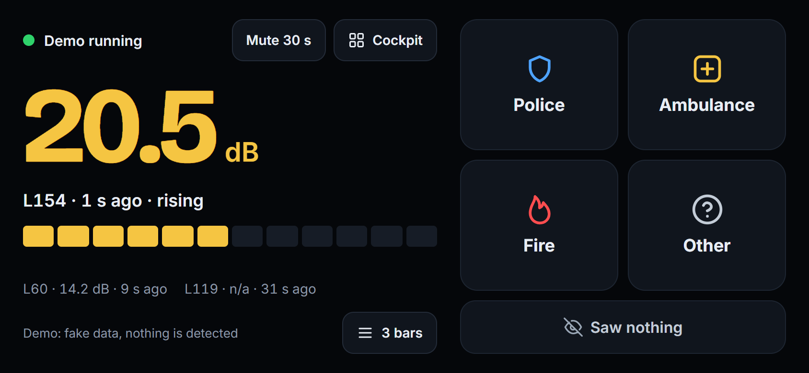 <b>One bar</b>, on a phone on its side</td>
<td align="center" width="45%">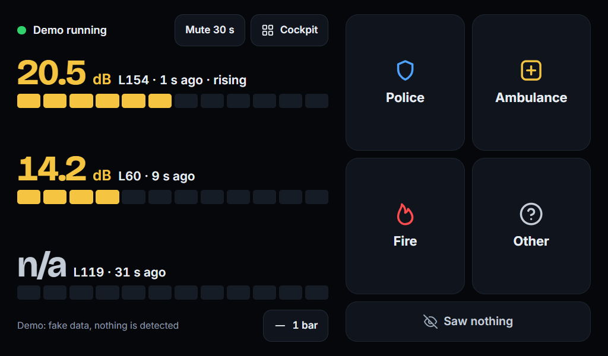 <b>Three bars</b>, on a 7-inch car computer screen</td>
</tr>
</table>
