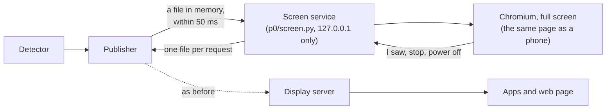

# The car computer's own screen

A screen attached to the car computer, for example a Raspberry Pi 5 case with an HDMI touchscreen, can
show the display page full screen from the moment the car powers it, with the phone used only for its
hotspot, or not at all. This page explains how it works, what was chosen and why, and what to watch for
in the hardware.

## How it works



- **Local, no internet.** The page and its data come from the car computer itself: no server, no network
  and no phone in between. Setting it up needs the car computer connected to a display server once, as for
  Bluetooth: the publisher that feeds the screen is installed with that connection. A recognised burst is on the screen within the publisher's 50 ms loop, faster
  than on a phone, and it keeps working where there is no signal.
- **The same page as a phone** (`display/page.html`): the cockpit (Live, Sightings, Car computer, Logs,
  Settings) and drive mode. One page to maintain, not a second program.
- **Requests from the screen** (a sighting, a recording, stop, power off, Pushover, Bluetooth, the setup
  check) go to the publisher as one file each, and are carried out exactly like the app's, by id, so one
  is never done twice. The Bluetooth link's key never goes this way; it only comes through the server.
  Collecting the log and support packages still go to the server, so they need internet.
- **Drive mode at every power-up**, whatever the screen was left on. Leave drive mode with **Cockpit**, and
  come back with **Drive mode**. Drive mode shows **one bar** (the strongest channel, the default) **or three**
  (the three strongest, each with its own bar); the button for it is at the foot of the left side. That choice
  is kept on the car computer (`~/.config/slot17-screen.json`, written so a power cut keeps it).
- **No Start tap and no pointer:** the kiosk browser may play sound without one, and the cursor is hidden
  for a touchscreen.
- **When the detector isn't running**, the screen says why (from systemd) instead of showing nothing. The
  screen service runs on its own, at every power-up.
- **Any size.** The page lays itself out for the screen it is on: a sidebar on a computer, a tab bar on a
  phone, an icon rail on a short landscape screen such as 800 × 480 or 1024 × 600, and drive mode fills any
  of them, landscape or portrait. Its text is never smaller than 12 px; `SLOT17_KIOSK_SCALE` zooms it for a
  screen where everything comes out too small or too large.

## Setting it up

```bash
bash setup.sh car --screen          # or, on its own:
sudo bash deploy/install-screen.sh  # --dry-run shows the plan; --off, --on, --uninstall
```

- **Raspberry Pi OS Lite** (no desktop, as the Slot17 image): cage, which shows one program full screen,
  runs Chromium on the first console (`deploy/slot17-kiosk.service`).
- **A desktop** (a display manager such as lightdm runs): Chromium starts with the desktop, from
  `~/.config/autostart/slot17-screen.desktop`; the desktop itself is left as it is.
- **Off again:** `sudo bash deploy/install-screen.sh --off`, or `bash setup.sh car --no-screen`. It stays off
  after a power-up.
- **Updates:** signed updates bring the page with the detector (as `p0/web/page.html`). The services
  themselves come with the installer.

## Why a web page in a kiosk browser, and not a Python program

| | Web page in Chromium (chosen) | A Python program (pygame or Qt) |
|---|---|---|
| Code to maintain | One page for phones, computers and the car screen | A fourth interface, after iPhone, Android and the web |
| Fits any screen | Built in (layout follows the screen) | Every size by hand |
| Speed | Within 50 ms of the publisher; buttons respond at once | About the same |
| Memory | About 250 to 400 MB | About 30 to 80 MB |
| Start-up | About 5 to 10 s on a Pi 5, while the detector starts anyway | About 1 to 2 s |
| Touch, sound | Built in | By hand |

The memory is no problem on a Pi 5 with 4 or 8 GB; the detector uses about 0.6 GB. On a 2 GB Pi it fits.
The browser runs at a low priority (`Nice`, `CPUWeight`), so the detector always comes first. A lighter
browser, WPE WebKit's `cog`, exists as a Debian package, but its support for the Pi 5's graphics and touch
is not documented well enough to rely on yet.

## The hardware: what to watch for

- **The Airspy inside the case.** Possible in a large enough case, but test it first. On 15 November 2026 a
  4G stick beside the Airspy put its LTE uplink straight into the receiver. A screen and its cable can do the
  same. Measure the noise floor (Car computer, Health) with the screen on and off before closing the case,
  keep the Airspy and its antenna cable away from the screen's cable and electronics, and use a short USB
  extension so the receiver doesn't sit against the Pi.
- **Power.** The screen takes its current from the Pi or from the same supply. Check for undervoltage
  (`bash ~/Slot17/setup.sh doctor`, or the app's Pi screen) with the screen and everything else connected. If
  it appears, use a 12 V to 5 V converter rated for 5 A (README, What you need).
- **Heat.** A closed case in a car in summer gets hot. Keep the Pi's cooler, and watch the temperature in
  Car computer, Health.
- **Sound.** Most small HDMI screens have no speaker and a Pi 5 has no headphone socket. The screen shows;
  the phone (app or web page) or a USB or Bluetooth speaker beeps.
- **Distraction and the law.** In many places a screen in the driver's view must not distract, and some
  devices may not be used while driving. Mount it where it is safe and check your country's rules
  ([LEGAL.md](../../LEGAL.md)).

## What this does not change

It shows that a TETRA radio transmitted and how strong it was. It does not identify a vehicle or measure
distance, on a phone or on this screen.

## The first look on the car computer, and what changed (26 November 2026)

The first version passed its tests and looked wrong on the car computer's own screen. Its fonts came from nowhere
(the design's Inter and Bricolage Grotesque were not on the Pi, and the screen has no internet), its channel cards and
drive mode were drawn from memory rather than from the design files, and drive mode was only looked at on phone-sized
screens. The page now carries both fonts, follows the design files' measurements, and draws drive mode at 844 x 390
and scales it as a whole. Lesson kept: look at the page at the target screen's own size, with its own data, next to
the design, before calling it done.

**Later the same day:** looked at with the Pi's own data, the empty Live page showed dashed placeholder cards (now one
panel that says why), the icon rail cut "Car computer" (now "Car"), and drive mode showed an empty bar. Then, at the
operator's request: the screen opens in drive mode at every start instead of the last mode, and drive mode can show
three bars. Drawing that found the alert line cut at its longest ("Urgent beep · 10 s ago" ended in "ag", and standing
up in "2 s ag"), because the design's top line has only Mute and this one also has Cockpit. Where it must, the line
now breaks after the dot, within the buttons' height.
